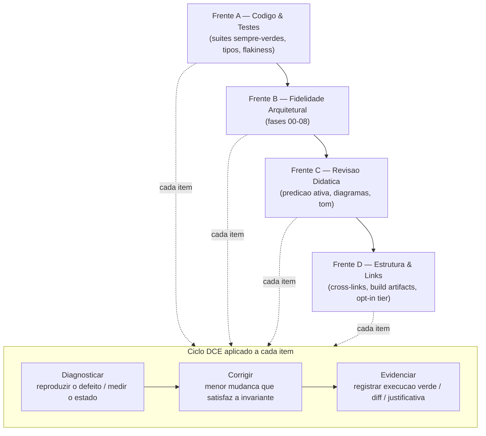
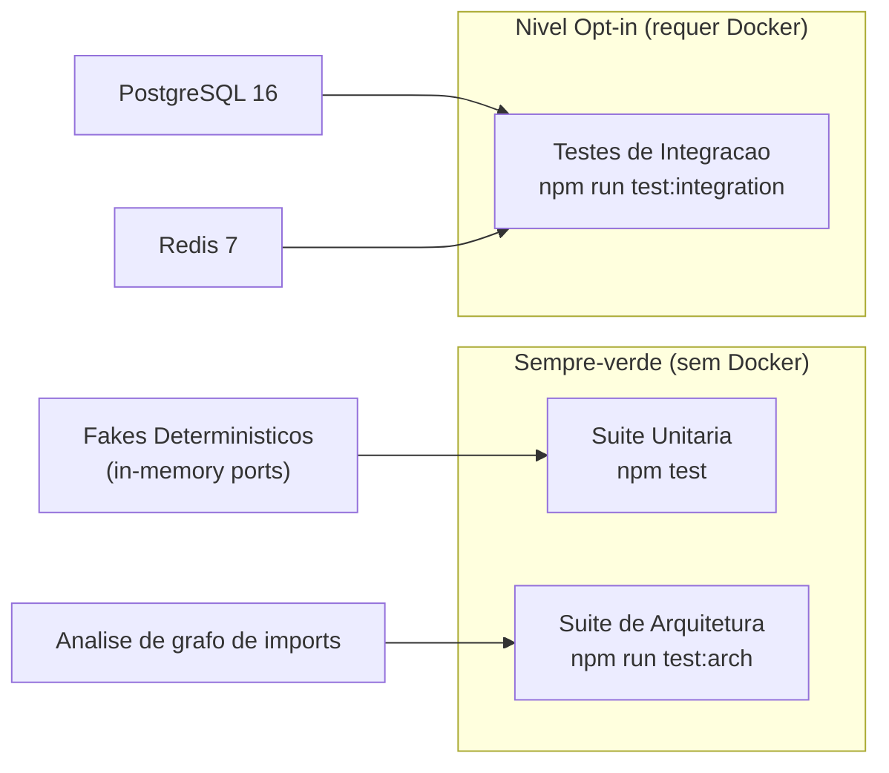

# Design Document

## Overview

Este documento descreve o desenho da auditoria, correção, refinamento arquitetural e revisão didática do repositório pedagógico **arch-lab**, conforme os requisitos em `requirements.md`. Não se trata de uma feature greenfield, e sim de um processo de engenharia aplicado a um artefato existente: nove fases de laboratório (`lab/00` a `lab/08`), documentação em três camadas (`docs/journey`, `docs/workbooks`, `docs/reference`), ADRs (`adr/`) e infraestrutura local (`docker-compose` com PostgreSQL 16 e Redis 7).

O design é organizado em torno de um motor de processo (as quatro Frentes de Auditoria rodando o Ciclo DCE), de uma estratégia de níveis de teste que mantém as suítes sempre-verdes 100% in-memory, de uma bateria de verificações de correção arquitetural por fase, de uma estratégia de determinismo para testes assíncronos, de um protocolo de revisão didática e de um conjunto de restrições de governança. A prosa permanece em português do Brasil; identificadores, nomes de arquivos, testes, commits e código permanecem em inglês (Requirement 9.7).

O estado atual observado que ancora este desenho:

- `package.json` já expõe `test` (`vitest run`), `test:arch` (`vitest run lab/00-fitness-functions`), `test:unit` (`vitest run --exclude '**/lab/00-fitness-functions/**'`) e `lint` (`tsc --noEmit`).
- `vitest.config.ts` inclui `lab/**/*.test.ts` e `lab/**/*.spec.ts` com `testTimeout: 10000`.
- Nenhum teste hoje abre conexão real com `pg` ou `ioredis`; essas strings aparecem apenas como dados de análise das Fitness Functions. As suítes já são, de fato, in-memory. O Nível Opt-in é, portanto, um andaime a ser introduzido sem regressão.
- `lab/07-resilience-patterns/resilience.test.ts` já usa `vi.useFakeTimers()` e costuras determinísticas (`sleep`, `random` injetáveis) — o padrão de determinismo a ser generalizado nas demais fases assíncronas.

---

## Architecture

Arquitetura do processo de auditoria — as quatro frentes e o Ciclo DCE.

### Visão geral (as quatro frentes e o Ciclo DCE)

A auditoria é um pipeline sequencial de quatro frentes (Requirement 9.1). Cada item dentro de uma frente é processado pelo Ciclo DCE — Diagnosticar → Corrigir → Evidenciar (Requirement 9.2).



O ordenamento A → B → C → D é intencional: corrigir primeiro a saúde mecânica (verde determinístico, tipos) estabelece uma base confiável antes de julgar fidelidade arquitetural; a fidelidade arquitetural precede a revisão didática porque a didática descreve o que o código faz; a consistência estrutural fecha por último, quando caminhos, scripts e links já estão estáveis.

### O Ciclo DCE em detalhe

Para cada item de auditoria, o Auditor executa três passos com artefatos distintos:

| Passo | Objetivo | Artefato de saída |
|---|---|---|
| **Diagnosticar** | Reproduzir o defeito ou medir o estado atual de forma objetiva (teste vermelho, flakiness observada, métrica incorreta, diagrama divergente, link quebrado). | Descrição do sintoma + comando/execução que o revela. |
| **Corrigir** | Aplicar a menor mudança que restaura a invariante, sem apagar conteúdo pedagógico (Requirement 9.3) e preservando fenômeno-antes-da-definição em reescritas (Requirement 9.5). | Diff de código/documento. |
| **Evidenciar** | Comprovar que a invariante passou a valer: execução verde de `npm test`/`npm run test:arch`, `run N times` estável, métrica recomputada, justificativa de trade-off para adições (Requirement 9.4). | Log de execução + nota de rationale quando aplicável. |

---

## Components and Interfaces

Esta seção descreve os componentes do processo e seus contratos: a estratégia de níveis de teste (suítes e seus limites), os Fakes Determinísticos que substituem infraestrutura, as verificações de correção arquitetural por fase e a estratégia de determinismo para testes assíncronos.

### Estratégia de Níveis de Teste

#### Objetivo e invariante central

As duas suítes sempre-verdes — Suíte Unitária (`npm test`) e Suíte de Arquitetura (`npm run test:arch`) — devem concluir com todos os testes aprovados em todas as fases e **sem qualquer dependência de infraestrutura real** (Requirements 1.1, 1.2, 1.3). Testes que precisam de PostgreSQL 16 ou Redis 7 pertencem a um **Nível Opt-in** separado, que só executa quando Docker está disponível (Requirements 1.4, 8.3).



#### Separação do Nível Opt-in

O desenho usa **convenção de nome de arquivo + projeto Vitest dedicado + guarda de ambiente**, combinando três camadas de defesa para que um teste de integração jamais entre acidentalmente na suíte sempre-verde:

1. **Convenção de nomenclatura.** Testes de integração recebem o sufixo `*.integration.test.ts`. Testes sempre-verdes continuam como `*.test.ts`/`*.spec.ts`.
2. **Separação por projeto Vitest.** `vitest.config.ts` passa a declarar dois projetos:
   - projeto `unit` com `include: ['lab/**/*.test.ts', 'lab/**/*.spec.ts']` e `exclude: ['**/*.integration.test.ts']`;
   - projeto `integration` com `include: ['lab/**/*.integration.test.ts']`.
   `npm test` roda apenas `unit`; um novo script `test:integration` roda apenas `integration`.
3. **Guarda de ambiente (cinto e suspensório).** Cada suíte de integração abre com uma guarda `describe.skipIf(!process.env.ARCH_LAB_INTEGRATION)` (ou verificação equivalente de disponibilidade de Docker/host). Assim, mesmo que o arquivo seja coletado fora de contexto, ele é pulado em vez de falhar por conexão recusada.

```typescript
// Esboço do vitest.config.ts com os dois projetos.
import { defineConfig } from 'vitest/config';

export default defineConfig({
  test: {
    globals: true,
    environment: 'node',
    testTimeout: 10000,
    projects: [
      {
        test: {
          name: 'unit',
          include: ['lab/**/*.test.ts', 'lab/**/*.spec.ts'],
          exclude: ['**/*.integration.test.ts'],
        },
      },
      {
        test: {
          name: 'integration',
          include: ['lab/**/*.integration.test.ts'],
        },
      },
    ],
  },
});
```

```typescript
// Esboço da guarda de ambiente em uma suite de integracao.
import { describe, it, expect } from 'vitest';

const integrationEnabled = process.env.ARCH_LAB_INTEGRATION === '1';

describe.skipIf(!integrationEnabled)('Outbox relay (integration, requires Postgres)', () => {
  it('persists message and command in a single transaction', async () => {
    // conecta ao Postgres real provisionado por docker compose
    expect(true).toBe(true);
  });
});
```

#### Fakes Determinísticos substituindo infraestrutura viva

Na camada sempre-verde, cada porta secundária (driven) que normalmente falaria com Postgres/Redis é implementada por um **Fake Determinístico** in-memory: um repositório em `Map`, um event store em array append-only, um broker em fila de memória. O Fake respeita o mesmo contrato de porta do adaptador real, de modo que o serviço de aplicação não distingue um do outro (isso também reforça o isolamento de domínio exigido na Frente B). Quando o Auditor encontra um teste sempre-verde que depende de infraestrutura real, a correção é refatorá-lo para o Fake ou movê-lo para o Nível Opt-in (Requirement 1.4).

| Infraestrutura real | Fake Determinístico (sempre-verde) | Usado nas fases |
|---|---|---|
| Repositório PostgreSQL | `InMemory*Repository` sobre `Map` | 02, 03, 08 |
| Event store PostgreSQL | Array append-only em memória com índices de versão | 04 |
| Tabela de Outbox + relay | Tabela de outbox em memória + relay com cursor | 05, 08 |
| Broker de mensagens | Fila em memória com entrega controlada | 05, 06, 08 |
| Cache Redis | `Map` com TTL simulado por relógio controlável | 07 |

---

### Verificações de Correção Arquitetural por Fase (Frente B)

Para cada fase, "correto" tem um significado operacional e verificável. A tabela e as subseções abaixo definem o critério e como o Auditor o comprova.

#### Fase 00 — Fitness Functions (Requirement 4.1)

**Correto significa:** a Fitness Function reprova de fato quando uma violação de camada é introduzida — ela "morde". Um teste que passa mesmo com a violação presente é falso-positivo (Requirement 2.1).

- **Diagnosticar:** injetar uma violação no código de amostra (p.ex. `sample-codebase/tainted-domain` importando `pg` no domínio) e confirmar que a Fitness Function acusa a violação com arquivo/linha/import. O motor atual (`FitnessRuleEngine.extractImportsFromSource`) já cobre import multi-linha, `import type`, re-export e `import`/`require` dinâmico; a verificação garante que esse espectro continua coberto.
- **Correto quando:** a avaliação retorna ao menos uma `ArchitectureViolation` para o import proibido e o teste de "prova negativa" (código limpo) retorna zero violações.

#### Fase 01 — Métricas de Modularidade (Requirement 4.2)

**Correto significa:** as métricas de Robert C. Martin são computadas pelas fórmulas canônicas, sem divergência numérica.

- Instabilidade: `I = Ce / (Ca + Ce)`, com `I = 0` definido para `Ca + Ce = 0` (componente sem acoplamento, tratado explicitamente para evitar divisão por zero).
- Abstração: `A = abstractTypes / totalTypes`, com `A = 0` definido para `totalTypes = 0`.
- Distância da Sequência Principal: `D = |A + I − 1|`.
- **Correto quando:** testes-exemplo com valores conhecidos (componente puramente abstrato e estável → `D ≈ 0`; componente concreto e instável → `D ≈ 0`; componente na "zona de dor"/"zona de inutilidade" → `D → 1`) batem com as fórmulas, e a propriedade de domínio (`0 ≤ I ≤ 1`, `0 ≤ A ≤ 1`, `0 ≤ D ≤ 1`) vale para qualquer grafo de imports gerado.

#### Fase 02 — Arquitetura Hexagonal (Requirements 4.3, 4.4)

**Correto significa:** o domínio depende somente de portas; nenhum framework ou driver de banco é importado no núcleo; portas primárias (driving) e secundárias (driven) e seus adaptadores estão estritamente separados.

- **Correto quando:** uma Fitness Function de pureza de domínio reprova qualquer import de `pg`/`ioredis`/`express` ou de `adapters/` dentro de `domain/` e `ports/`; o `CreateOrderService` opera indistintamente sobre Fakes in-memory e adaptadores reais; o grafo de dependências aponta apenas para dentro (regra da dependência).

#### Fase 03 — DDD Tático (Requirement 5.1)

**Correto significa:** o Aggregate Root protege invariantes (nenhuma mutação que viole a regra de negócio é possível por fora dele) e os Value Objects são imutáveis e autovalidantes — sem modelo anêmico.

- **Correto quando:** tentativas de transição inválida no agregado lançam erro de domínio; VOs rejeitam construção inválida e não expõem setters; `Object.freeze`/`readonly` garantem imutabilidade; igualdade de VO é estrutural. Propriedade: para qualquer sequência de operações válidas, as invariantes do agregado permanecem verdadeiras.

#### Fase 04 — CQRS & Event Sourcing (Requirement 5.2)

**Correto significa:** separação entre modelo de escrita (comandos) e modelo de leitura (projeções); event store append-only; replay determinístico.

- **Correto quando:** o event store nunca sobrescreve nem remove eventos (somente append, com versão monotônica); reconstruir o estado a partir do mesmo log sempre produz o mesmo agregado (replay determinístico); a projeção de leitura é derivável exclusivamente do log. Propriedade central: `replay(events) == replay(events)` e `state_after_commands == replay(event_log)`.

#### Fase 05 — EDA & Transactional Outbox (Requirements 5.3, 5.4)

**Correto significa:** o fenômeno do dual-write é demonstrado em código **antes** da solução (fenômeno-antes-da-definição); o relay/polling do Outbox é idempotente.

- **Correto quando:** existe um cenário executável que exibe a inconsistência do dual-write (commit no banco e publicação no broker divergindo sob falha), seguido do Outbox que escreve estado + mensagem na mesma transação; entregar o mesmo evento mais de uma vez ao consumidor produz o mesmo efeito de uma entrega (consumidor idempotente). Propriedade: para qualquer evento `e` e qualquer `n ≥ 1`, `apply(e)` repetido `n` vezes tem o mesmo efeito observável que `apply(e)` uma vez.

#### Fase 06 — Sagas Distribuídas (Requirement 6.1)

**Correto significa:** as compensações da Saga são idempotentes e cobrem falhas em estados intermediários.

- **Correto quando:** uma falha em cada passo intermediário dispara exatamente as compensações dos passos já concluídos, em ordem inversa; reexecutar uma compensação não causa efeito adicional (idempotência); ao final de um rollback completo o sistema volta a um estado consistente equivalente ao anterior ao início da Saga. Propriedade: para qualquer ponto de falha `k` na Saga, o conjunto de compensações aplicadas é exatamente o dos passos `0..k-1`.

#### Fase 07 — Padrões de Resiliência (Requirement 6.2)

**Correto significa:** Circuit Breaker, Bulkhead, Retry com Backoff + Jitter e Throttling com semântica de produção.

- **Correto quando:** o Circuit Breaker transita CLOSED → OPEN no limiar, faz fail-fast em OPEN sem invocar a ação protegida, vai a HALF_OPEN após o cooldown e re-OPEN se a chamada de teste falha; o Bulkhead rejeita acima do limite de concorrência e libera slots ao concluir; o Retry aplica backoff exponencial com full jitter e respeita classificação de erro não-retryável; o Throttling limita a taxa conforme configurado. Esses comportamentos já têm base verde em `resilience.test.ts` e serão mantidos determinísticos (ver seção de determinismo).

#### Fase 08 — Capstone Enterprise Checkout (Requirements 6.3, 6.4)

**Correto significa:** o checkout distribuído integra de forma coesa Hexagonal, DDD, Saga orquestrada com compensação, Transactional Outbox e Fitness Functions; qualquer vazamento de infraestrutura no núcleo é reprovado por Fitness Function.

- **Correto quando:** os bounded contexts (Orders, Payments, Inventory) mantêm núcleos isolados; a Saga orquestra o fluxo com compensação automática sob falha; o Outbox garante entrega sem dual-write; e as Fitness Functions do capstone (`capstone-fitness.test.ts`) reprovam import de `pg`/`ioredis`/`express` ou de `adapters/` dentro de domínio/portas — incluindo uma "prova negativa" em que um agregado fictício que importa o driver é detectado.

---

### Estratégia de Determinismo para Testes Assíncronos e de Concorrência (Frente A)

#### Objetivo

Testes de Outbox, Sagas, condições de corrida e Circuit Breaker devem ser determinísticos; nenhuma intermitência é aceitável (Requirement 3.1). A estratégia elimina dependência de tempo real de parede e de aleatoriedade não controlada (Requirement 3.3).

#### Mecanismos

1. **Relógios e agendadores controláveis (fake timers).** Usar `vi.useFakeTimers()` com `vi.advanceTimersByTime(ms)` para cooldowns de Circuit Breaker, TTL de cache e janelas de throttling — como já feito em `resilience.test.ts`. O tempo avança por comando do teste, nunca pela parede.
2. **Costuras de injeção (seams).** Funções sensíveis a tempo/aleatoriedade recebem `sleep` e `random` injetáveis (padrão já presente em `retryWithBackoff`). Nos testes, `sleep: async () => {}` elimina espera e `random: () => 0.5` torna o jitter previsível, permitindo asserções exatas sobre a sequência de delays.
3. **Sincronização explícita em vez de "dormir e torcer".** Condições de corrida (p.ex. single-flight no cache, limites de Bulkhead) são coordenadas por promessas resolvidas manualmente (`resolveTaskN`) e `Promise.all`, dando controle determinístico sobre a ordem de conclusão.
4. **Relay/consumidor dirigidos por tick, não por intervalo real.** O polling do Outbox e a entrega do broker expõem um método `tick()`/`drain()` que o teste chama explicitamente, substituindo `setInterval` por avanço controlado.

#### Verificação "run N times"

Para cada teste previamente intermitente, o critério de aceite é obter resultados idênticos de aprovação em execuções repetidas consecutivas (Requirement 3.2). O desenho adota `N = 10` como piso. A verificação é feita por execução repetida do alvo, por exemplo:

```bash
# Repete 10 vezes o teste alvo; interrompe no primeiro fracasso.
for i in $(seq 1 10); do npx vitest run lab/05-eda-and-outbox || exit 1; done
```

O critério é satisfeito quando as 10 execuções passam. Essa verificação faz parte do passo **Evidenciar** do Ciclo DCE para itens da Frente A ligados a concorrência.

---

## Protocolo de Revisão Didática (Frente C)

### Predição Ativa preservada

Todo workbook mantém o ciclo Objetivo → Hipótese → Faça → Observe → Reflexão/Gabarito, com o gabarito recolhido em bloco `<details><summary>` para forçar raciocínio ativo antes da revelação (Requirements 7.1, 7.4). O Auditor não remove etapas; quando reescreve, preserva fenômeno-antes-da-definição — a observação do problema aparece antes da formalização (Requirement 9.5).

```markdown
## Exercício N — Título

**Objetivo:** o que o aluno vai provar.
**Hipótese:** registre sua predição antes de rodar.
**Faça:** passos com caminhos relativos (ex.: `lab/05-eda-and-outbox/outbox.test.ts`).
**Observe:** o que o terminal mostra.

<details><summary>Ver explicação e gabarito</summary>

Resultado esperado + porquê, ligando ao código real da fase.

</details>
```

### Validade e correspondência de diagramas

Todo diagrama Mermaid/C4 deve ser sintaticamente válido e corresponder ao código do laboratório que descreve (Requirement 7.2). O Auditor valida a sintaxe (render mental/ferramenta) e confere nó a nó que componentes, portas e adaptadores do diagrama existem com os mesmos nomes no `lab/` correspondente. Divergência entre diagrama e código é um defeito a corrigir no diagrama ou (se o código mudou corretamente) na legenda.

### Tom e caminhos

Mantém-se o tom sênior-para-sênior, instruções precisas e **caminhos relativos** em lições e workbooks (Requirement 7.3). Caminhos absolutos de máquina são proibidos no conteúdo.

---

## Consistência Estrutural e Links (Frente D)

### Cross-link validation

O Auditor valida que os links entre `README.md`, documentos de `docs/` e diretórios de `lab/` resolvem para destinos existentes (Requirements 8.1, 8.4). A verificação percorre cada link interno (markdown `[texto](caminho)` e âncoras `#secao`) e confirma que o arquivo/seção existe; links quebrados são corrigidos para o destino certo, nunca removidos silenciosamente.

### Sincronização de artefatos de build

`package.json` (scripts), `Makefile`, `Dockerfile` e `docker-compose.yml` são mantidos sincronizados com o código real das fases (Requirement 8.2). Pontos de atenção derivados do estado atual:

- Introduzir `test:integration` em `package.json` e um alvo correspondente no `Makefile` (p.ex. `test-integration`) coerente com `docker compose`, já que o compose provê Postgres 16 e Redis 7 com healthchecks.
- Garantir que `test:arch` e `test:unit` continuem particionando corretamente as suítes após a adoção dos projetos Vitest (o `--exclude` de `test:unit` e o alvo `test:arch` devem refletir a nova configuração).
- Conferir que serviços/variáveis do `docker-compose.yml` (hosts, portas, credenciais de desenvolvimento) batem com o que o Nível Opt-in espera via `process.env`.

---

## Data Models

Modelo de dados — os artefatos de rastreabilidade da auditoria.

A auditoria em si não introduz um esquema de banco; seu "modelo de dados" são os artefatos de rastreabilidade produzidos pelo Ciclo DCE. Representação conceitual:

```typescript
type Frente = 'A' | 'B' | 'C' | 'D';
type Fase = '00' | '01' | '02' | '03' | '04' | '05' | '06' | '07' | '08';

interface AuditItem {
  frente: Frente;
  fase?: Fase;            // ausente para itens transversais (ex.: cross-links)
  requirementRefs: string[]; // ex.: ['1.1', '1.3']
  diagnose: string;      // sintoma + comando que o revela
  correct: string;       // descrição do diff aplicado
  evidence: string;      // log verde / "run N times" / métrica recomputada
  tradeoffNote?: string; // obrigatório quando o item ADICIONA artefatos (Req 9.4)
}
```

---

## Error Handling

Tratamento de erros e modos de falha do processo de auditoria.

| Situação | Tratamento no desenho |
|---|---|
| Teste sempre-verde depende de infra real | Refatorar para Fake Determinístico ou mover para Nível Opt-in; nunca deixar a suíte verde depender de Docker (Req 1.4, 8.3). |
| Teste falso-positivo (passa sem asserir) | Corrigir para asserir o comportamento real ou substituir por teste equivalente (Req 2.1). |
| `any`/cast inseguro sob modo estrito | Substituir por tipagem explícita; se exigir mudança de contrato de porta, ajustar a porta preservando isolamento de domínio (Req 2.2, 2.4). |
| Teste assíncrono intermitente | Aplicar relógio/scheduler controlável + sincronização explícita; validar com `run N times` (Req 3.1–3.3). |
| Fitness Function que não "morde" | Corrigir a regra/engine até que a violação injetada seja reprovada (Req 4.1, 6.4). |
| Diagrama divergente do código | Corrigir o diagrama (ou a legenda) para corresponder ao `lab/` (Req 7.2). |
| Link interno quebrado | Corrigir para o destino existente (Req 8.4). |
| Tentação de apagar conteúdo "ruim" | Proibido: melhorar ou substituir preservando fenômeno-antes-da-definição (Req 9.3, 9.5). |
| Segredo encontrado no VCS | Remover do controle de versão; nenhuma credencial/senha/`.env` real permanece (Req 9.6). |

---

## Testing Strategy

Estratégia de testes — abordagem dupla (exemplo + propriedade).

### Abordagem dupla

- **Testes-exemplo (unit):** comprovam exemplos concretos, pontos de integração entre componentes e casos de borda/erro (transições específicas de estado, construção inválida de VO, erro não-retryável).
- **Testes de propriedade:** comprovam propriedades universais sobre muitos inputs gerados (replay determinístico, idempotência de consumidor/compensação, limites `0 ≤ I,A,D ≤ 1`). Cada teste de propriedade roda no mínimo 100 iterações e referencia a propriedade correspondente deste documento, no formato **Feature: arch-lab-audit, Property {n}: {texto}**.

As Fitness Functions são tratadas como testes de arquitetura (grafo de imports) e permanecem na Suíte de Arquitetura (`npm run test:arch`), 100% in-memory.

---

## Correctness Properties

*Uma propriedade é uma característica ou comportamento que deve valer em todas as execuções válidas do sistema — uma afirmação formal sobre o que o sistema deve fazer. Propriedades são a ponte entre a especificação legível por humanos e garantias de correção verificáveis por máquina.*

### Property 1: Fitness Function reprova violações de camada

*Para qualquer* código-fonte que importe um módulo proibido (driver de banco, framework web ou um adaptador concreto) dentro de uma camada de domínio ou de porta, a avaliação das regras SHALL retornar ao menos uma violação identificando arquivo, linha e import; e *para qualquer* código-fonte sem imports proibidos, a avaliação SHALL retornar zero violações.

**Validates: Requirements 4.1, 6.4**

### Property 2: Limites das métricas de Martin

*Para qualquer* grafo de imports de um componente, as métricas computadas satisfazem `I = Ce / (Ca + Ce)` (com `I = 0` quando `Ca + Ce = 0`), `A = abstractTypes / totalTypes` (com `A = 0` quando `totalTypes = 0`) e `D = |A + I − 1|`, de modo que `0 ≤ I ≤ 1`, `0 ≤ A ≤ 1` e `0 ≤ D ≤ 1`.

**Validates: Requirements 4.2**

### Property 3: Invariantes do Aggregate Root são preservadas

*Para qualquer* sequência de operações válidas aplicadas ao Aggregate Root da fase 03, as invariantes de negócio permanecem verdadeiras ao final da sequência, e qualquer operação que violaria uma invariante é rejeitada com erro de domínio.

**Validates: Requirements 5.1**

### Property 4: Imutabilidade e igualdade estrutural de Value Objects

*Para qualquer* Value Object construído com dados válidos, não existe operação que mute seu estado interno, e dois Value Objects com os mesmos dados são estruturalmente iguais; dados inválidos SHALL ser rejeitados na construção.

**Validates: Requirements 5.1**

### Property 5: Replay determinístico do event store

*Para qualquer* log de eventos append-only, reconstruir o estado a partir do log produz sempre o mesmo agregado (`replay(log) == replay(log)`), e o estado obtido após aplicar uma sequência de comandos é igual ao estado reconstruído a partir do log resultante (`state_after_commands == replay(event_log)`).

**Validates: Requirements 5.2**

### Property 6: Idempotência do consumidor de Outbox

*Para qualquer* evento e qualquer número de entregas `n ≥ 1`, aplicar o evento `n` vezes no consumidor idempotente produz o mesmo efeito observável que aplicá-lo uma única vez.

**Validates: Requirements 5.4**

### Property 7: Cobertura e idempotência das compensações da Saga

*Para qualquer* ponto de falha `k` em uma Saga de `m` passos, o conjunto de compensações executadas é exatamente o dos passos `0..k-1` em ordem inversa, e reexecutar qualquer compensação não produz efeito adicional além da primeira execução.

**Validates: Requirements 6.1**

### Property 8: Semântica do Circuit Breaker

*Para qualquer* configuração de limiar e cooldown, o Circuit Breaker transita para OPEN ao atingir o limiar de falhas consecutivas, faz fail-fast sem invocar a ação protegida enquanto OPEN, transita para HALF_OPEN somente após decorrido o cooldown, fecha ao sucesso da chamada de teste e re-abre imediatamente se a chamada de teste falha.

**Validates: Requirements 6.2**

### Property 9: Backoff exponencial com full jitter

*Para qualquer* configuração de `baseDelayMs` e número de tentativas com full jitter e fonte de aleatoriedade controlada, a sequência de atrasos produzida corresponde ao teto exponencial escalado pelo fator de jitter, e erros classificados como não-retryáveis interrompem as tentativas imediatamente.

**Validates: Requirements 6.2**

### Property 10: Isolamento de infraestrutura no capstone

*Para qualquer* arquivo de domínio ou de porta em qualquer bounded context do capstone, a Fitness Function reprova a presença de import de driver de banco, framework web ou adaptador concreto, garantindo que o núcleo de negócio não vaze infraestrutura.

**Validates: Requirements 6.3, 6.4**

### Property 11: Suítes sempre-verdes são independentes de infraestrutura

*Para qualquer* execução de `npm test` ou `npm run test:arch` sem Docker/infra disponível, todas as suítes concluem com aprovação, pois toda porta secundária é satisfeita por um Fake Determinístico e nenhum teste da camada sempre-verde abre conexão com PostgreSQL ou Redis.

**Validates: Requirements 1.1, 1.2, 1.3**

### Property 12: Determinismo de testes assíncronos sob repetição

*Para qualquer* teste assíncrono ou de concorrência tornado determinístico, executá-lo N vezes consecutivas (N ≥ 10) produz N resultados idênticos de aprovação, pois tempo e aleatoriedade são controlados por relógios/costuras injetáveis em vez de tempo real de parede.

**Validates: Requirements 3.1, 3.2, 3.3**

---

## Decisões de Design e Trade-offs

### D1 — Separar o Nível Opt-in por projeto Vitest + convenção de nome + guarda de ambiente (Req 1.4, 8.3)

**Decisão:** usar três camadas (projeto dedicado, sufixo `*.integration.test.ts`, guarda `skipIf`) em vez de uma única.

**Trade-off:** há alguma redundância (a guarda de ambiente é "cinto e suspensório" sobre a separação por projeto). Aceitamos a redundância porque o custo é baixo e o benefício — impossibilitar que um teste de integração vaze para a suíte sempre-verde e quebre o verde em uma máquina sem Docker — é central ao Requirement 1.3. A alternativa de depender só do `--exclude` por path é frágil a renomeações.

### D2 — Fakes Determinísticos in-memory em vez de containers efêmeros na suíte verde (Req 1.3)

**Decisão:** a suíte sempre-verde usa Fakes in-memory; infra real fica no Opt-in.

**Trade-off:** Fakes podem divergir do comportamento real do Postgres/Redis (p.ex. semântica transacional sutil). Mitigação: os mesmos cenários críticos (transação do Outbox, idempotência) têm também um teste de integração no Opt-in que roda contra a infra real quando Docker está presente. Ganhamos verde rápido e determinístico para alunos/CI sem sacrificar a prova com infra real.

### D3 — Determinismo por costuras injetáveis e fake timers em vez de esperas reais (Req 3.1–3.3)

**Decisão:** generalizar o padrão já presente em `resilience.test.ts` (sleep/random injetáveis, `vi.useFakeTimers`) e relay/broker dirigidos por `tick()`.

**Trade-off:** exige expor seams de teste no código de produção (ligeira perda de encapsulamento). Justifica-se porque elimina flakiness, que é mais caro pedagogicamente (um aluno que vê um teste vermelho aleatório perde confiança no laboratório) e operacionalmente (CI instável). Alternativa de aumentar timeouts apenas mascara a corrida.

### D4 — Ordem fixa das frentes A → B → C → D (Req 9.1)

**Decisão:** manter o sequenciamento linear por frente, cobrindo todas as fases dentro de cada frente.

**Trade-off:** menos paralelismo entre frentes e possível retrabalho se uma correção da Frente B exigir reavaliar a Frente A. Aceita-se porque uma base mecânica estável (verde determinístico, tipos) é pré-condição para julgar fidelidade arquitetural e didática com confiança; a rastreabilidade do Ciclo DCE também fica mais clara com fronteiras de frente nítidas.

### D5 — Complementar, nunca remover (Req 9.3, 9.5)

**Decisão:** reescritas preservam fenômeno-antes-da-definição e nenhuma lição/workbook/lab é apagado.

**Trade-off:** o repositório pode crescer e acumular andaimes. Aceita-se por alinhamento direto com a filosofia pedagógica do `AGENTS.md`: o avanço se dá por refinamento e scaffolding, e perder a demonstração de um fenômeno (p.ex. o dual-write antes do Outbox) destruiria valor didático insubstituível.

### D6 — Toda adição exige nota de trade-off (Req 9.4)

**Decisão:** novos testes, Fitness Functions, ADRs ou seções de workbook carregam uma justificativa de trade-off no passo Evidenciar.

**Trade-off:** mais cerimônia por adição. Justifica-se porque mantém a governança rastreável e evita crescimento não intencional; o registro vira documentação viva (coerente com a cultura de ADRs do repositório).
