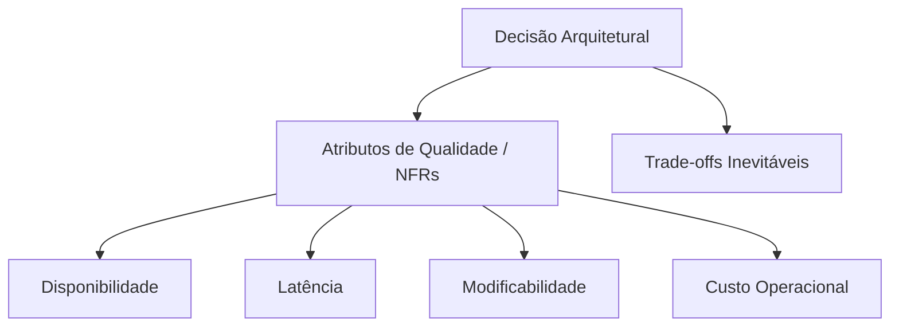

# Jornada — Parte 1: Fundamentos, Métricas de Acoplamento & Governança Arquitetural

## 🎯 Pergunta Condutora
> *"Por que sistemas bem intencionados se transformam em Big Balls of Mud com o passar dos meses, e como um arquiteto pode automatizar a governança para que regras de fronteira nunca sejam violadas por engano?"*

---

## 1. Fase 0: O Papel do Arquiteto & Fitness Functions

### O que realmente é Arquitetura?
Arquitetura de software não é sobre escolher os frameworks mais modernos do mercado. Como definiu Martin Fowler e Ralph Johnson:
> *"Arquitetura são as decisões que você gostaria de acertar no início de um projeto porque elas são difíceis e custosas de mudar depois."*

Toda decisão arquitetural envolve **trade-offs**. Não existem soluções perfeitas; existem apenas escolhas com conjuntos diferentes de vantagens e dores.



### Documentação Viva: ADRs & Modelo C4
- **ADRs (Architectural Decision Records):** Registros concisos e imutáveis com Contexto, Decisão e Consequências.
- **Modelo C4 (Simon Brown):** Quatro níveis hierárquicos de zoom:
  1. *Context:* O sistema e seus usuários/sistemas externos.
  2. *Containers:* Aplicações executáveis, microsserviços, bancos de dados.
  3. *Components:* Módulos estruturais internos de um contêiner.
  4. *Code:* Classes, interfaces e diagramas de sequência.

### Fitness Functions: Arquitetura como Teste Automatizado
Para impedir a erosão arquitetural, usamos **Fitness Functions**: testes unitários que inspecionam os imports extraídos do código-fonte e o grafo de dependências entre módulos.
Se um desenvolvedor importar `pg` ou `express` dentro de uma entidade de domínio, o teste falha no CI.

### Modelo Mental / Analogia da Vida Real
> **Analogia:**
> - **Fitness Function como o Inspetor de Incêndio:** Imagine um fiscal que visita o canteiro de obras toda semana com uma trena. Se alguém construir uma parede bloqueando uma saída de emergência ou usar fiação fora da especificação da norma técnica, a obra é interditada na hora. As fitness functions são fiscais automatizados no CI que impedem que alguém "fure o cano mestre" do domínio por pressa.
> - **C4 Model como o Google Maps:** Você começa vendo o continente inteiro (*Level 1: System Context*), aproxima o zoom para ver os bairros e cidades (*Level 2: Containers*), dá zoom na rua para ver os prédios e comércios (*Level 3: Components*) e, finalmente, entra na sala do prédio para ver as mesas e móveis (*Level 4: Code*). Ninguém tenta navegar de um estado para o outro olhando a foto das mesas!

---

## 2. Fase 1: Princípios de Modularidade & Métricas de Martin

### Métricas Formais de Pacotes (Robert C. Martin)

Dada uma coleção de pacotes ou módulos:
- **Acoplamento Aferente ($C_a$):** Número de módulos externos que dependem do módulo analisado.
- **Acoplamento Eferente ($C_e$):** Número de módulos externos dos quais o módulo analisado depende.
- **Instabilidade ($I$):**
  $$I = \frac{C_e}{C_a + C_e}$$
  - $I = 0$: Módulo **Máximamente Estável** (muitos dependem dele, ele não depende de ninguém).
  - $I = 1$: Módulo **Máximamente Instável** (ninguém depende dele, ele depende de muitos; fácil de alterar sem quebrar terceiros).

- **Abstração ($A$):**
  $$A = \frac{N_a}{N_c}$$
  Onde $N_a$ é a quantidade de interfaces e tipos abstratos e $N_c$ é o total de classes/tipos no pacote.

- **A Sequência Principal & Distância ($D$):**
  A relação ideal entre abstração e estabilidade é a linha $A + I = 1$.
  $$D = |A + I - 1|$$

```text
    Abstração (A)
    1.0 | [Zona da Inutilidade]     Sequência Principal (A + I = 1)
        |       \                         /
        |         \                     /
        |           \                 /
        |             \             /
    0.0 |               \         /      [Zona da Dor]
        +----------------------------------------
       0.0                                     1.0  Instabilidade (I)
```

- **Zona da Dor ($A \approx 0, I \approx 0$):** Código concreto do qual muitos dependem. Alterar é arriscado e doloroso.
- **Zona da Inutilidade ($A \approx 1, I \approx 1$):** Abstrações puras que ninguém consome. Complexidade acidental.

### Modelo Mental / Analogia da Vida Real
> **Analogia:**
> - **Instabilidade ($I$):** Uma pipa ao vento versus uma rocha de 50 toneladas. A pipa ($I = 1$) se move facilmente sem afetar o solo (fácil de mudar, ninguém se apoia nela). A rocha ($I = 0$) sustenta as vigas do viaduto: se você tentar empurrá-la ou perfurá-la, o viaduto inteiro pode colapsar.
> - **A Sequência Principal:** Se um módulo for uma rocha de fundação ($I = 0$), ele precisa ser feito de contratos abstratos ($A = 1$, interfaces) para permitir flexibilidade sem quebrar quem se apoia nele. Concreto rígido sem abstrações na fundação cria a temida *Zona da Dor* (ninguém tem coragem de mexer).

---

## 🔬 Checkpoint Prático da Parte 1

Execute o laboratório e complete os workbooks:
- Workbook: [`docs/workbooks/00-fitness-functions-workbook.md`](../workbooks/00-fitness-functions-workbook.md)
- Lab: [`lab/00-fitness-functions/`](../../lab/00-fitness-functions)
- Workbook: [`docs/workbooks/01-modularity-metrics-workbook.md`](../workbooks/01-modularity-metrics-workbook.md)
- Lab: [`lab/01-modularity-metrics/`](../../lab/01-modularity-metrics)
