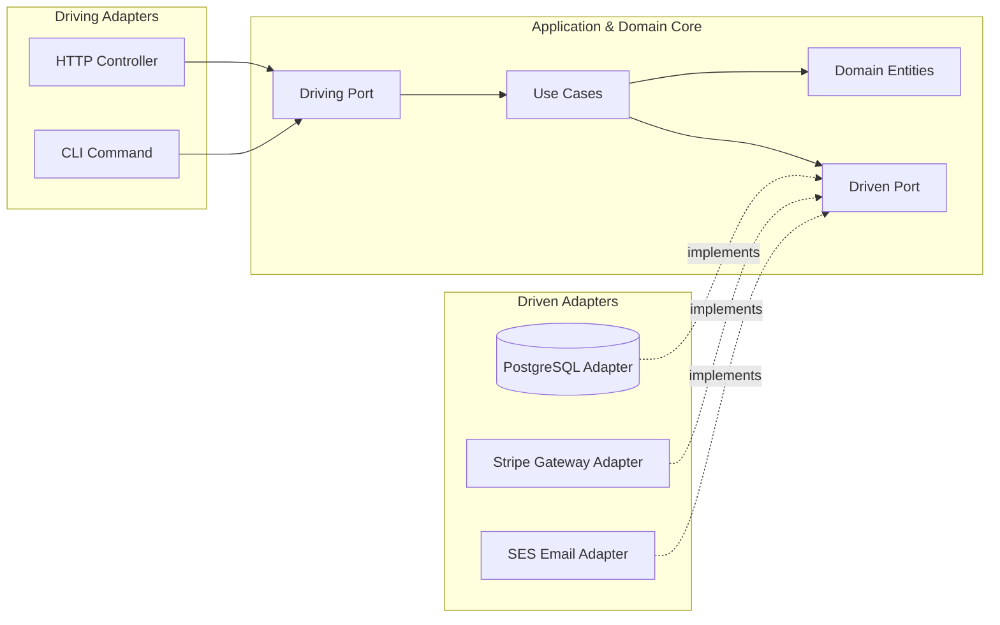

# Jornada — Parte 2: Arquitetura Hexagonal, Clean Architecture & Domain-Driven Design

## 🎯 Pergunta Condutora
> *"Por que migrar de banco de dados ou criar testes de integração se torna um pesadelo em sistemas N-Tier tradicionais, e como a Arquitetura Hexagonal e o DDD Tático criam um núcleo de negócio imune a mudanças externas?"*

---

## 1. Fase 2: Arquitetura Hexagonal (Ports & Adapters) & Clean Architecture

### As Falhas do "Database-Driven Design"
No modelo tradicional de 3 camadas:
$$\text{Controller} \longrightarrow \text{Service} \longrightarrow \text{Repository / ORM Entity} \longrightarrow \text{Database}$$

A entidade do ORM (decorada com anotações de tabela SQL) vaza para dentro da camada de serviço e até dos controllers. Quando o schema do banco muda, as regras de negócio quebram. Se você quiser rodar um teste unitário de uma regra de negócio, é obrigado a subir um banco ou simular dezenas de tabelas.

### A Solução Hexagonal (Alistair Cockburn)
A Arquitetura Hexagonal inverte essa dependência:
1. **Core de Domínio:** Contém entidades puras e casos de uso, sem saber se o banco é Postgres, MongoDB ou um Array em memória.
2. **Driving Ports (Inbound):** Interfaces que expõem o que a aplicação pode fazer (ex: `CreateOrderUseCase`).
3. **Driven Ports (Outbound):** Interfaces que definem o que o domínio precisa (ex: `OrderRepositoryPort`, `PaymentGatewayPort`).
4. **Adapters:** Ficam no mundo exterior implementando as portas (ex: `PostgresOrderRepository`, `StripePaymentAdapter`, `HttpOrderController`).

---

## 2. Fase 3: Domain-Driven Design (DDD) Estratégico & Tático

### DDD Estratégico
- **Linguagem Ubíqua:** Sem ambiguidade técnica. Se o especialista de negócio fala "Cancelar Pedido com Estorno", o código não deve ter `order.setStatus(3)`.
- **Bounded Contexts:** Limites explícitos. O conceito de `Cliente` no contexto de Vendas possui atributos completamente diferentes do `Cliente` no contexto de Faturamento.
- **Context Mapping:**
  - **Shared Kernel:** Código compartilhado de forma controlada.
  - **Anti-Corruption Layer (ACL):** Camada adaptadora que traduz modelos de APIs legadas para os modelos do domínio puro.

### DDD Tático: Morte ao Modelo Anêmico
Um **Modelo Anêmico** é uma casca vazia cheia de getters e setters onde qualquer controller pode corromper o estado interno do objeto (ex: alterar o saldo sem validar limite).

No **Modelo Rico**:
1. **Value Objects (VOs):** Imutáveis, sem identidade própria (`Money`, `Email`, `Sku`). A validação ocorre na instanciação.
2. **Entities:** Possuem identidade única (`OrderId`) e mutabilidade controlada por métodos de negócio.
3. **Aggregate Root:** A única porta de entrada para manipular entidades filhas, garantindo **invariantes transacionais** em 100% do tempo.
4. **Domain Events:** Emissão de fatos que aconteceram no passado (`OrderPlacedEvent`).

---

## 🔬 Checkpoint Prático da Parte 2

Execute o laboratório e complete os workbooks:
- Workbook: [`docs/workbooks/02-hexagonal-architecture-workbook.md`](file:///Users/andersonalves/dev/arch-lab/docs/workbooks/02-hexagonal-architecture-workbook.md)
- Lab: [`lab/02-hexagonal-architecture/`](file:///Users/andersonalves/dev/arch-lab/lab/02-hexagonal-architecture)
- Workbook: [`docs/workbooks/03-ddd-tactical-workbook.md`](file:///Users/andersonalves/dev/arch-lab/docs/workbooks/03-ddd-tactical-workbook.md)
- Lab: [`lab/03-domain-driven-design/`](file:///Users/andersonalves/dev/arch-lab/lab/03-domain-driven-design)
