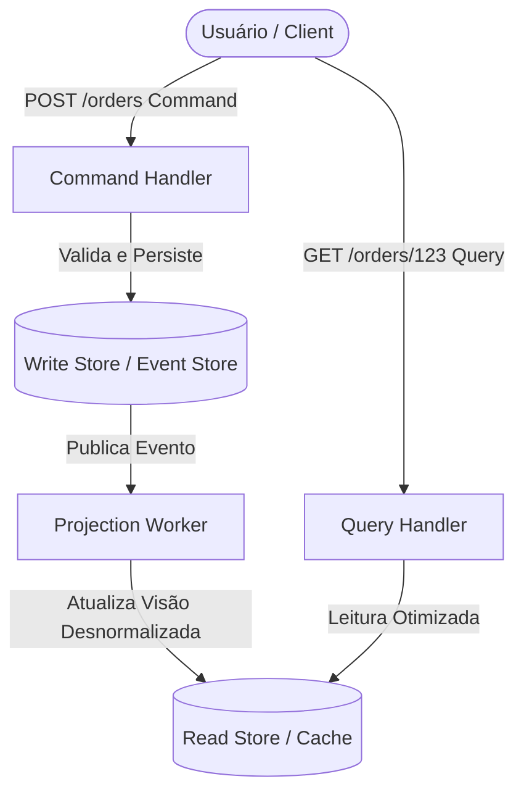
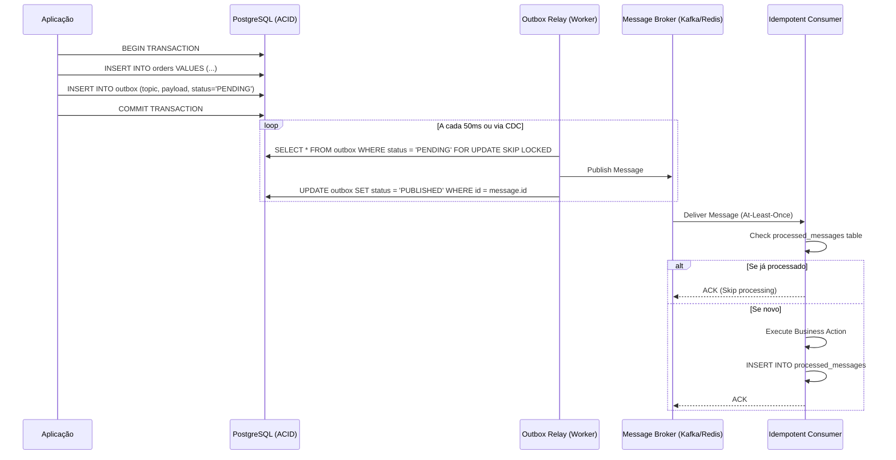

# Jornada — Parte 3: Persistência Avançada, CQRS, Event Sourcing & EDA

## 🎯 Pergunta Condutora
> *"Como escalar leituras e escritas de alta volumetria sem gerar gargalos de locks relacionais, e como garantir mensageria assíncrona à prova de falhas eliminando o desastre do Dual-Write?"*

---

## 1. Fase 4: Padrões de Persistência, CQRS & Event Sourcing

### O Dilema do Modelo Único de Dados
Em sistemas tradicionais, a mesma tabela relacional atende:
1. **Escritas transacionais:** Que exigem normalização estrita (3FN), chaves estrangeiras e locks atômicos para garantir invariantes.
2. **Leituras analíticas e dashboards:** Que exigem agregações massivas, joins complexos e desnormalização para baixa latência.

O resultado é contenção de locks: relatórios pesados travam operações de escrita de checkout.

### CQRS (Command Query Responsibility Segregation)
O CQRS separa esses caminhos:
- **Command Model:** Otimizado exclusivamente para validação de regras de negócio e mutação consistente.
- **Query Model (Projections):** Tabelas ou documentos desnormalizados otimizados para leitura instantânea por chave primária, atualizados de forma assíncrona.



### Event Sourcing: O Log Imutável
Em vez de sobrescrever o saldo com `UPDATE accounts SET balance = 100`, persistimos a sequência histórica de fatos imutáveis:
1. `AccountCreated(id=1, initial=0)`
2. `MoneyDeposited(id=1, amount=150)`
3. `MoneyWithdrawn(id=1, amount=50)`

O saldo atual ($100$) é reconstruído via **Event Replay**. Para otimizar performance com milhares de eventos, geramos **Snapshots** periódicos.
A concorrência é tratada via **Optimistic Concurrency** verificando o número de versão do stream (`expectedVersion`).

### Modelo Mental / Analogia da Vida Real
> **Analogia:**
> - **Event Sourcing como o Extrato Bancário e a Contabilidade:** Em contabilidade profissional, ninguém passa borracha no livro de balanço quando entra dinheiro. Se você deposita R$ 100, é uma nova linha; se saca R$ 40, é outra linha. O saldo é apenas a soma matemática de todas as linhas já registradas no histórico. Se você descobrir um erro de 3 meses atrás, você não apaga o passado: você lança um novo evento de estorno ou correção!
> - **CQRS como uma Cozinha de Restaurante:** O garçom anota os pedidos dos clientes (os *Commands*, que entram numa fila rigorosa e ordenada na bancada do chef). A recepção e os clientes no salão apenas consultam o cardápio impresso ou o painel de senhas prontas (as *Queries/Projections*, leitura instantânea sem atrapalhar as panelas no fogão).

---

## 2. Fase 5: Arquiteturas Orientadas a Eventos (EDA) & Mensageria Resiliente

### A Armadilha Fatal do Dual-Write
Considere o código comum:
```typescript
await db.query("INSERT INTO orders VALUES (...)"); // 1. Commit no Banco
await messageBroker.publish("order-created", payload); // 2. Publica no Kafka/RabbitMQ
```
**O que acontece se o servidor cair ou a rede falhar exatamente entre a linha 1 e 2?**
O pedido existe no banco, mas os sistemas de pagamento e envio nunca serão notificados. O cliente é cobrado ou o produto nunca é enviado.

### A Solução: Transactional Outbox Pattern
Salvamos a intenção de mensagem dentro da **mesma transação ACID** do banco relacional:



### Modelo Mental / Analogia da Vida Real
> **Analogia:**
> - **Transactional Outbox como a Caixa de Saída dos Correios na sua Porta:** Em vez de assinar o contrato na mesa do escritório e depois arriscar perder o papel na caminhada até a agência postal na chuva, você coloca a carta na caixinha de correspondência parafusada na porta da sua sala durante a assinatura. O carteiro oficial (o *Relay Worker*) passa e esvazia a caixa. Se o carteiro tropeçar, a carta ainda está lá segura para o próximo turno.
> - **Idempotent Consumer como o Recebimento de Encomenda com Protocolo:** O porteiro tem um caderno com os códigos de rastreio das encomendas entregues. Se o entregador tocar a campainha duas vezes com o mesmo pacote duplicado, o porteiro confere o código no caderno, vê que já recebeu aquele número, assina o comprovante para liberar o entregador, mas não guarda duas caixas idênticas no depósito.

---

## 🔬 Checkpoint Prático da Parte 3

Execute o laboratório e complete os workbooks:
- Workbook: [`docs/workbooks/04-cqrs-event-sourcing-workbook.md`](../workbooks/04-cqrs-event-sourcing-workbook.md)
- Lab: [`lab/04-cqrs-event-sourcing/`](../../lab/04-cqrs-event-sourcing)
- Workbook: [`docs/workbooks/05-eda-outbox-workbook.md`](../workbooks/05-eda-outbox-workbook.md)
- Lab: [`lab/05-eda-and-outbox/`](../../lab/05-eda-and-outbox)
