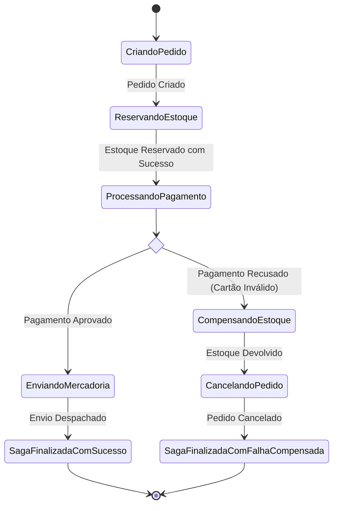

# Jornada — Parte 4: Transações Distribuídas (Sagas), Resiliência & Capstone Corporativo

## 🎯 Pergunta Condutora
> *"Como orquestrar transações atômicas de negócio em múltiplos microsserviços sem locks distribuídos e como proteger a infraestrutura contra falhas em cascata e tempestades de requisições?"*

---

## 1. Fase 6: Transações Distribuídas & O Padrão Saga

### Por que Two-Phase Commit (2PC) falha na nuvem?
O protocolo clássico 2PC bloqueia (*locks*) todos os recursos participantes durante as fases de preparação (*Prepare*) e efetivação (*Commit*). Se um nó sofrer lentidão ou partição de rede, todas as transações concorrentes entram em espera, gerando colapso de disponibilidade.

### A Alternativa Saga: Transações Locais + Compensação
Uma **Saga** é uma sequência de transações locais em cada serviço.
Se um passo falhar no meio do caminho, o Orquestrador executa **Transações Compensatórias** (*Compensating Transactions*) em ordem reversa:

### Modelo Mental / Analogia da Vida Real
> **Analogia:**
> - **Saga e Transação Compensatória como a Reserva de Férias:** Você quer viajar para a praia: primeiro compra a passagem aérea na companhia A; depois reserva o hotel na pousada B; depois aluga o carro na locadora C. Se a locadora C não tiver mais carros disponíveis, você não fica abandonado na praia: você aciona a garantia de cancelamento e cancela a reserva da pousada e o voo da companhia A, recebendo estorno em cada empresa individualmente.
> - **Por que não 2PC (Two-Phase Commit):** 2PC seria como obrigar a companhia aérea, a pousada e a locadora a ficarem na mesma chamada telefônica com a linha congelada até que todas confirmem ao mesmo tempo. Se a recepcionista da pousada for ao banheiro, ninguém no mundo compra passagens de avião!

---

## 2. Fase 7: Resiliência, Escalabilidade & Padrões Distribuídos

### Padrões Essenciais de Resiliência
1. **Circuit Breaker (Martin Fowler):**
   - `CLOSED`: Operação normal. Conta falhas consecutivas.
   - `OPEN`: Limiar excedido. Rejeita imediatamente sem chamar a dependência degradada (*fail fast*).
   - `HALF_OPEN`: Janela de teste. Permite chamadas limitadas para verificar se o serviço recuperou.
2. **Bulkhead Pattern:** Isola limites de concorrência por dependência (ex: 20 requisições simultâneas para o Gateway de Frete e 50 para o Gateway de Pagamentos).
3. **Cache Stampede / Thundering Herd:**
   - Problema: 1000 requisições concorrentes chegam no milissegundo em que a chave de cache expira. Todas as 1000 chamadas batem no banco de dados, derrubando o PostgreSQL.
   - Solução: **Single-Flight Mutex Lock** — apenas a primeira requisição vai ao banco; as outras 999 aguardam a promessa do cache ser preenchida.

### Modelo Mental / Analogia da Vida Real
> **Analogia:**
> - **Circuit Breaker como o Disjuntor da Caixa de Força:** Se a fiação do chuveiro superaquecer e ameaçar queimar a fiação da casa inteira, o disjuntor desarma imediatamente (*OPEN*), cortando a corrente elétrica. Em vez de continuar forçando o chuveiro quebrado (sobrecarregando um microsserviço que já está lento), o sistema rejeita novas chamadas de imediato com erro rápido. Quando a poeira baixa, você arma o disjuntor em teste (*HALF_OPEN*).
> - **Bulkhead como as Paredes Estanques de um Submarino:** Se um compartimento do casco for perfurado por um recife, as portas de aço selam aquela sala para que a água não inunde o submarino inteiro. Se o serviço de envio de SMS estiver lento, ele não pode sequestrar todas as threads e conexões do servidor e derrubar a compra com cartão de crédito.
> - **Cache Stampede como a Portaria do Show na Abertura dos Portões:** Se o ingresso de todos expirar no mesmo segundo, milhares de pessoas esmagam o segurança na catraca do estádio. Com Single-Flight, um único líder vai à bilheteria buscar a lista atualizada enquanto os outros 999 aguardam pacificamente na fila organizada.

---

## 3. Fase 8: Capstone Sênior — E-commerce Corporativo Completo

No Capstone corporativo, integramos todos os pilares em um sistema de ponta a ponta:
- Três Bounded Contexts isolados: `Orders`, `Payments`, `Inventory`.
- Núcleo de domínio puro com Arquitetura Hexagonal.
- Orquestração de Saga com Máquina de Estados e compensações transacionais testadas.
- Transactional Outbox para propagação de eventos.
- Fitness Functions validando a ausência de vazamento de acoplamento entre contextos.

---

## 🔬 Checkpoint Prático da Parte 4

Execute o laboratório e complete os workbooks:
- Workbook: [`docs/workbooks/06-distributed-sagas-workbook.md`](../workbooks/06-distributed-sagas-workbook.md)
- Lab: [`lab/06-distributed-sagas/`](../../lab/06-distributed-sagas)
- Workbook: [`docs/workbooks/07-resilience-patterns-workbook.md`](../workbooks/07-resilience-patterns-workbook.md)
- Lab: [`lab/07-resilience-patterns/`](../../lab/07-resilience-patterns)
- Workbook: [`docs/workbooks/08-capstone-enterprise-checkout-workbook.md`](../workbooks/08-capstone-enterprise-checkout-workbook.md)
- Lab: [`lab/08-capstone-enterprise-checkout/`](../../lab/08-capstone-enterprise-checkout)
