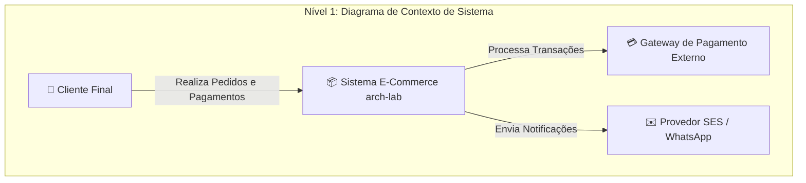
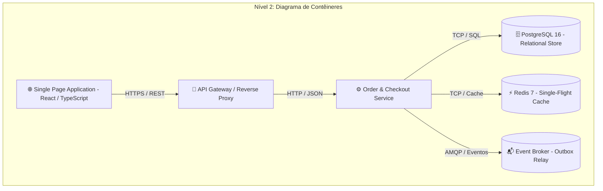
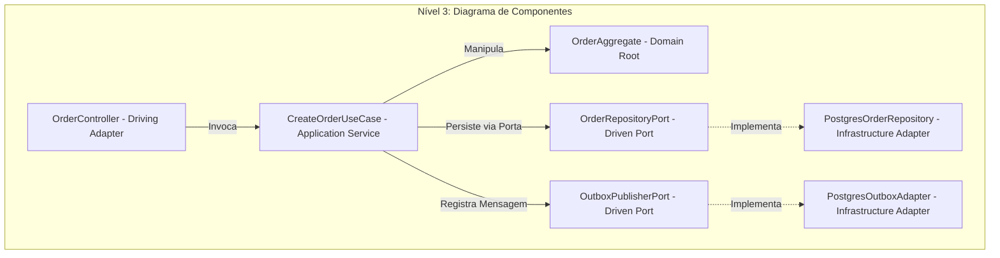

# Guia de Referência 00: O Papel do Arquiteto, Trade-offs & Modelagem C4

## 1. O Papel do Arquiteto de Software Moderno
O papel do Arquiteto de Software evoluiu drasticamente nas últimas décadas. Ele deixou de ser o desenvolvedor que emite ordens isolado em uma "torre de marfim" para se tornar um líder técnico capacitador e estrategista de sistemas:

- **Decisões Difíceis de Reverter:** A arquitetura é o conjunto de decisões técnicas que são extremamente custosas ou arriscadas de alterar no futuro (ex: particionamento de banco, escolha de protocolo síncrono vs assíncrono, modelo de consistência).
- **Balanceamento de Atributos de Qualidade (NFRs - Non-Functional Requirements):** Nenhum sistema pode maximizar todos os atributos simultaneamente. O arquiteto equilibra latência, disponibilidade, custo de infraestrutura, tempo de entrega e segurança.
- **Governança Automatizada (Fitness Functions):** Em vez de criar documentos de 200 páginas que ninguém lê, o arquiteto codifica as regras de arquitetura como testes automatizados que rodam no CI.

---

## 2. Modelagem Arquitetural com o Modelo C4 (Simon Brown)

O **Modelo C4** cria uma hierarquia de mapas conceituais (semelhante ao Google Maps com zoom-in progressivo) para comunicar sistemas de software de forma clara para diferentes públicos:







---

## 3. Documentação Viva: Architectural Decision Records (ADRs)

Um **ADR** é um documento imutável e versionado no Git que registra uma decisão arquitetural relevante tomada no projeto:

| Seção do ADR | Finalidade |
|---|---|
| **Título & Status** | Ex: `ADR 004: Transactional Outbox vs Dual-Write (Accepted)` |
| **Contexto** | O problema, forças em conflito, requisitos de negócio e restrições operacionais. |
| **Decisão** | A escolha técnica exata adotada pela equipe. |
| **Consequências** | Efeitos positivos obtidos e custos/débitos técnicos aceitos conscientemente. |

---

## 4. Fitness Functions na Prática

Uma **Fitness Function** (termo cunhado por Neal Ford e Rebecca Parsons) é uma função de avaliação objetiva e automatizada que mede o quão próxima a arquitetura está de seus objetivos e restrições:

```typescript
// Exemplo de Fitness Function estática no Vitest
test("Regra Arquitetural: O Domínio não pode importar nenhum driver de banco", () => {
  const violations = scanForbiddenImports({
    sourcePath: "src/domain",
    forbiddenPackages: ["pg", "typeorm", "prisma", "express", "axios", "ioredis"]
  });
  expect(violations).toHaveLength(0);
});
```
