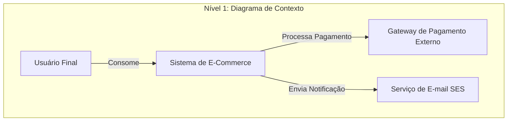
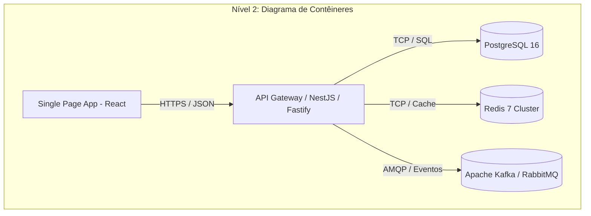
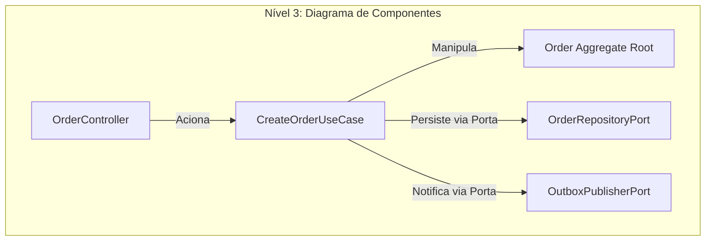

# Guia de Referência 00: O Papel do Arquiteto, Trade-offs & Modelagem C4

## 1. O Papel do Arquiteto de Software Moderno
O arquiteto moderno não é um emissor de ordens em torre de marfim ("Ivory Tower Architect"). Ele atua como um facilitador técnico e estrategista de longo prazo:
- **Alinhamento com o Negócio:** Garantir que as decisões técnicas viabilizem a estratégia da empresa.
- **Gerenciamento de Trade-offs:** Balancear atributos de qualidade conflitantes (ex: consistência forte vs latência ultra-baixa).
- **Governança Automatizada:** Estabelecer Fitness Functions para que as diretrizes sejam respeitadas pelo CI.

---

## 2. Modelagem com o Modelo C4 (Simon Brown)

O modelo C4 organiza a arquitetura em 4 níveis de abstração hierárquica:







---

## 3. Fitness Functions na Prática
Uma Fitness Function é um teste automatizado que mede a integridade de um atributo arquitetural:

```typescript
// Exemplo conceitual de Fitness Function
test('domain layer must not depend on database drivers', () => {
  const violations = scanImports({
    targetDir: 'src/domain',
    forbiddenPackages: ['pg', 'typeorm', 'mongoose', 'express', 'axios'],
  });
  expect(violations).toHaveLength(0);
});
```
