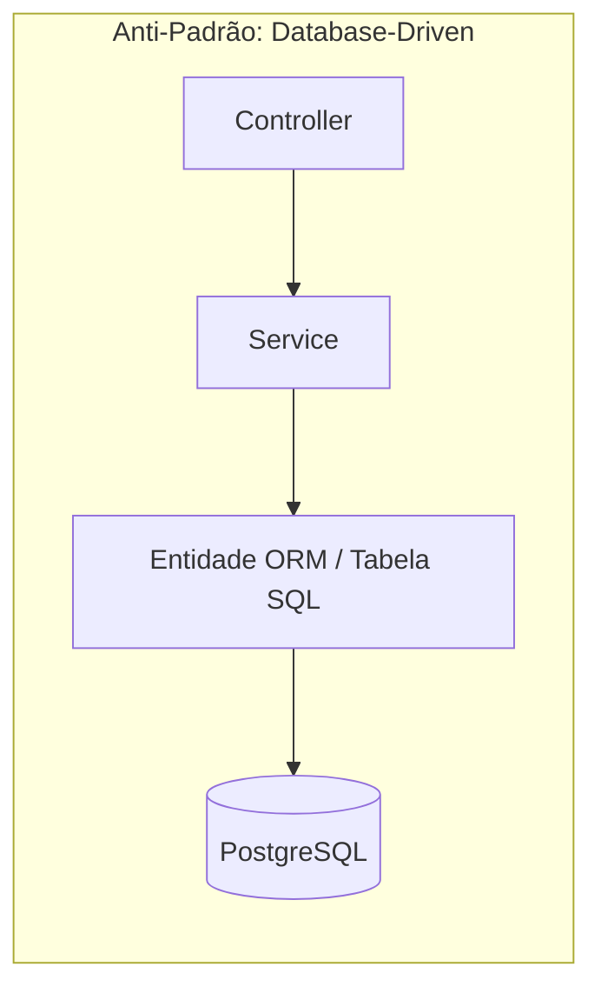
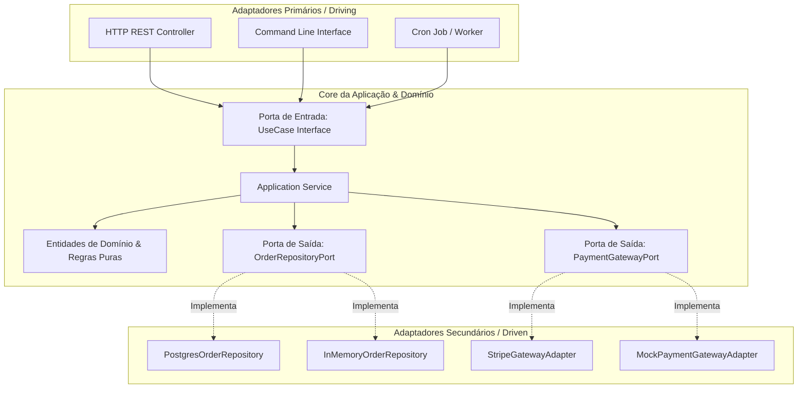

# Guia de Referência 02: Arquitetura Hexagonal & Clean Architecture

## 1. As Falhas da Arquitetura N-Tier Tradicional (*Database-Driven Design*)

Na arquitetura tradicional de 3 camadas (Controller $\to$ Service $\to$ Repository/DAO), o modelo de dados do banco de dados relacional é o centro gravitacional do sistema.

### Por que isso é tóxico para a evolução do sistema?
1. **Contaminação de Tipos:** A anotação `@Column({ length: 50 })` ou tipos de banco vazam para regras de negócio.
2. **Testes Lentos e Frágeis:** Não é possível testar um cálculo de juros sem inicializar uma conexão de banco de dados ou mockar dezenas de métodos de ORMs complexos.
3. **Impossibilidade de Substituição de Infraestrutura:** Se a empresa decide adotar um banco colunar ou cache Redis, o domínio inteiro precisa ser reescrito.

---

## 2. Arquitetura Hexagonal (Ports & Adapters - Alistair Cockburn)

A Arquitetura Hexagonal inverte a gravidade do sistema: o **Domínio de Negócio é o centro do universo**, completamente agnóstico de tecnologias externas.

### Elementos Estruturais
- **Portas Primárias (Driving/Inbound):** Definem O QUE a aplicação faz (Casos de Uso consumidos por Controllers e CLIs).
- **Portas Secundárias (Driven/Outbound):** Definem O QUE a aplicação precisa do mundo exterior (Repositórios, Mensageria, Gateways de Pagamento).
- **Adaptadores:** Tradutores tecnológicos que convertem requisições HTTP/SQL para os tipos e portas do Domínio.
