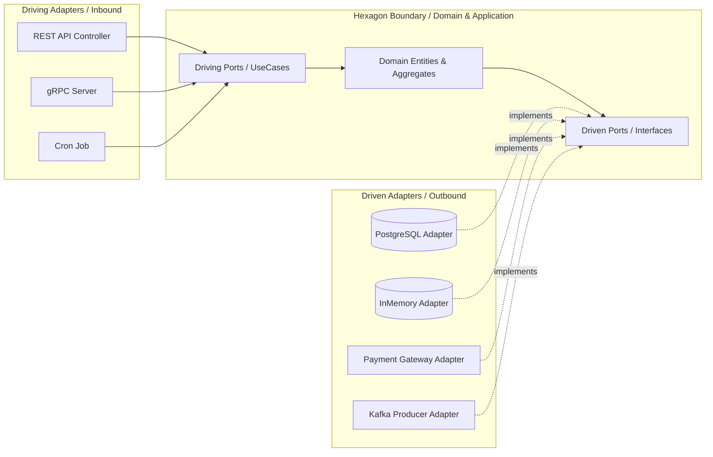

# Guia de Referência 02: Arquitetura Hexagonal & Clean Architecture

## 1. Arquitetura Hexagonal (Ports & Adapters) — Alistair Cockburn

O objetivo central da Arquitetura Hexagonal é permitir que uma aplicação seja igualmente acionada por usuários humanos, programas externos, testes automatizados ou scripts em lote, e que ela seja desenvolvida e testada de forma isolada de seus dispositivos e bancos de dados em tempo de execução.



---

## 2. A Regra da Dependência da Clean Architecture

Proposta por Robert C. Martin (Uncle Bob), a **Regra da Dependência** estabelece:
> *"As dependências do código-fonte só podem apontar para dentro, na direção de políticas de nível mais alto."*

```text
+-------------------------------------------------------------+
| Frameworks & Drivers (DB, Web, UI, External Interfaces)     |
|   +-------------------------------------------------------+ |
|   | Interface Adapters (Controllers, Gateways, Presenters) | |
|   |   +-------------------------------------------------+ | |
|   |   | Application Business Rules (Use Cases)          | | |
|   |   |   +-------------------------------------------+ | | |
|   |   |   | Enterprise Business Rules (Entities, VOs) | | | |
|   |   |   +-------------------------------------------+ | | |
|   |   +-------------------------------------------------+ | |
|   +-------------------------------------------------------+ |
+-------------------------------------------------------------+
               Direção das Dependências: PARA DENTRO --->
```

### Regras Invioláveis de Camadas:
1. **Entities & Value Objects:** Não possuem nenhuma dependência externa, nem de banco de dados, nem de frameworks.
2. **Use Cases:** Orquestram o fluxo de dados para e a partir das entidades, dependendo apenas de interfaces (Ports).
3. **Interface Adapters:** Convertem dados do formato mais conveniente para os casos de uso e entidades para o formato exigido por agentes externos (ex: HTTP JSON para DTOs de comando).
4. **Frameworks & Drivers:** Todo detalhe volátil (Postgres, Redis, Express, Fastify) reside aqui.
