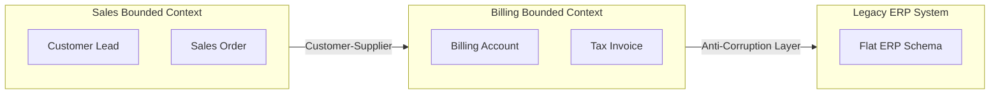

# Guia de Referência 03: Domain-Driven Design (DDD) Estratégico & Tático

## 1. DDD Estratégico: O Mapeamento do Negócio

### 1.1 Classificação de Subdomínios
- **Core Domain:** O diferencial competitivo da empresa. Onde reside o valor único de negócio e deve receber a maior atenção técnica.
- **Supporting Domain:** Domínios complementares essenciais para o negócio, mas que não representam o diferencial central.
- **Generic Domain:** Componentes padrão e commodities (ex: autenticação, faturamento fiscal padrão, envio de e-mails).

### 1.2 Bounded Contexts & Context Mapping



- **Anti-Corruption Layer (ACL):** Camada que atua como tradutor bidirecional para proteger o modelo limpo do novo domínio contra a poluição semântica de APIs legadas ou contratos de terceiros.

---

## 2. DDD Tático: Construindo Modelos Ricos

### 2.1 Value Objects (VOs)
- Imutáveis.
- Igualdade baseada em valores de atributos (Structural Equality), não em ID.
- Auto-validação no construtor.
- Métodos puros que retornam novas instâncias (Side-Effect Free).

### 2.2 Aggregate & Aggregate Root
- O **Aggregate Root** é a única entidade externa visível para clientes de persistência e orquestração.
- Todas as mutações e regras de invariantes (ex: *um pedido não pode exceder o limite de crédito do cliente*) são executadas exclusivamente dentro dos métodos da raiz do agregado.
- Garante fronteiras atômicas de transação: uma transação de banco altera exatamente **um agregado**.

```typescript
// Exemplo canônico de Aggregate Root Rico
export class OrderAggregate {
  private readonly _items: OrderItem[] = [];
  private _status: OrderStatus = OrderStatus.DRAFT;

  public addItem(sku: Sku, price: Money, quantity: number): void {
    if (this._status !== OrderStatus.DRAFT) {
      throw new DomainInvariantViolationError('Cannot modify items of a non-draft order');
    }
    this._items.push(new OrderItem(sku, price, quantity));
  }

  public calculateTotal(): Money {
    return this._items.reduce(
      (acc, item) => acc.add(item.totalPrice),
      Money.zero('BRL')
    );
  }
}
```
