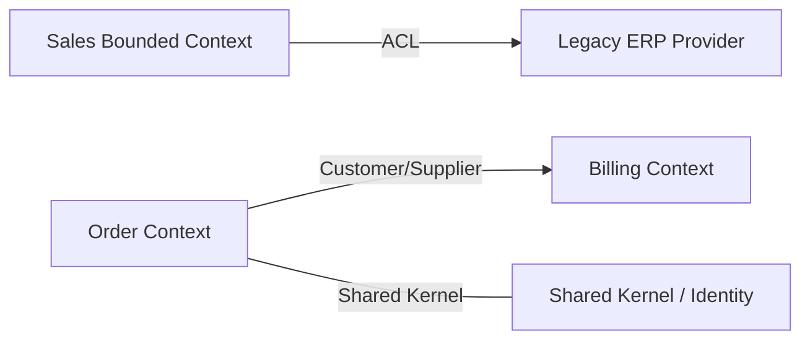
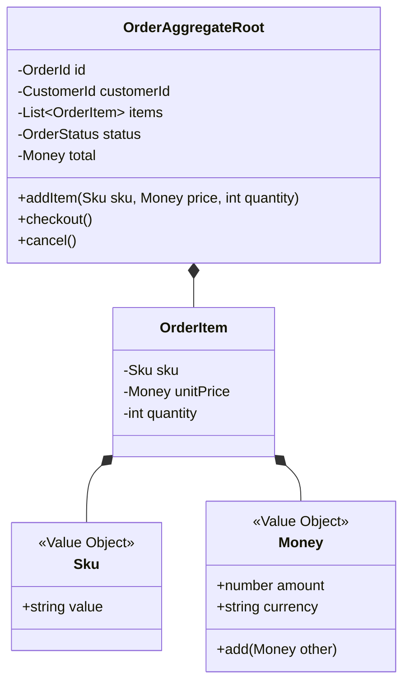

# Guia de Referência 03: Domain-Driven Design (DDD) Estratégico & Tático

## 1. DDD Estratégico: Mapeando a Complexidade do Negócio

O Domain-Driven Design (Eric Evans) ensina que software corporativo de sucesso nasce da modelagem fiel do domínio de negócio:

### 1.1 Subdomínios de Negócio
- **Core Domain:** O coração do negócio, a vantagem competitiva da empresa (ex: o algoritmo de precificação dinâmica da Uber ou o motor de recomendações da Netflix).
- **Supporting Domain:** Suporte operacional necessário, mas que não diferencia a empresa no mercado (ex: cadastro de motoristas, controle de inventário simples).
- **Generic Domain:** Componentes de prateleira ou commodities que podem ser terceirizados (ex: gateway de envio de SMS, faturamento padrão, autenticação OAuth2).

### 1.2 Bounded Contexts & Linguagem Ubíqua
Um **Bounded Context** é a fronteira semântica explícita dentro da qual um modelo de domínio se aplica estritamente.
A palavra "Cliente" significa coisas completamente diferentes no *Contexto de Vendas* (nome, lead score, funil de conversão) e no *Contexto Fiscal* (CNPJ, inscrição estadual, retenção de impostos).

### 1.3 Padrões de Context Mapping

- **Anti-Corruption Layer (ACL):** Camada de tradução que protege o domínio limpo contra modelos sujos ou legados de terceiros.
- **Shared Kernel:** Subconjunto de código compartilhado entre dois times (exige extrema disciplina).
- **Customer-Supplier:** O contexto fornecedor adapta suas entregas às necessidades do cliente.

---

## 2. DDD Tático: Construindo Blocos de Domínio Ricos

### Invariantes Transacionais e Aggregate Roots
- **Entidades:** Objetos definidos por sua identidade contínua única ao longo do tempo (ex: `OrderId`).
- **Value Objects:** Objetos imutáveis definidos unicamente pelo valor de todos os seus atributos. Não possuem identidade. Substituem tipos primitivos genéricos.
- **Aggregate Root (Raiz do Agregado):** Entidade guardiã de uma fronteira de consistência transacional. Nenhuma entidade interna pode ser alterada sem passar pela validação da raiz.
