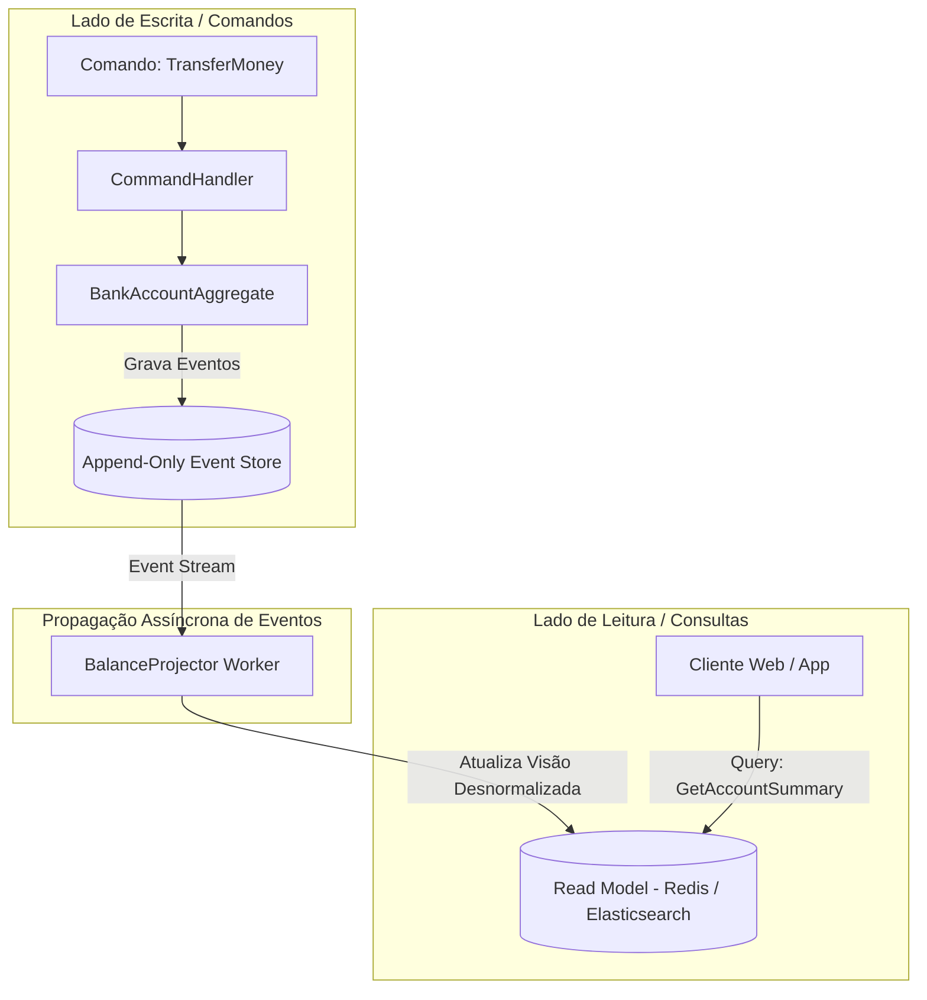

# Guia de Referência 04: Padrões de Persistência, CQRS & Event Sourcing

## 1. O Dilema do Modelo Único de Persistência

Em sistemas tradicionais, o mesmo modelo de dados relacional atende a escrita (transações, normalização 3FN, locks) e a leitura (relatórios, agregações, filtros). Isso cria um conflito insolúvel:
- Para escrever com segurança, você precisa de tabelas normalizadas e transações ACID estritas.
- Para ler com alta velocidade em páginas de alto tráfego, você precisa de dados desnormalizados e índices compostos.

---

## 2. CQRS (Command Query Responsibility Segregation - Greg Young)

O CQRS divide a aplicação em dois modelos arquiteturais independentes:



---

## 3. Event Sourcing: O Log Imutável de Eventos

Em vez de armazenar apenas o estado final atual de uma entidade (sobrescrevendo o saldo com `UPDATE accounts SET balance = 500`), o **Event Sourcing** armazena a sequência cronológica completa de eventos que levaram a esse estado.

### Anatomia de um Event Store
| Stream ID | Versão | Tipo de Evento | Payload JSON | Timestamp UTC |
|---|---|---|---|---|
| `acc-001` | 1 | `AccountOpened` | `{"owner": "Alice"}` | 2026-08-27T10:00:00Z |
| `acc-001` | 2 | `MoneyDeposited` | `{"amount": 1000, "currency": "BRL"}` | 2026-08-27T10:05:00Z |
| `acc-001` | 3 | `MoneyWithdrawn` | `{"amount": 300, "currency": "BRL"}` | 2026-08-27T11:20:00Z |

```text
Estado Atual (Reidratação): 
Saldo = 0 + 1000 - 300 = 700 BRL
```

### Concorrência Otimista com `expectedVersion`
Para evitar conflitos de gravação sem travar o banco:
```typescript
await eventStore.appendEvents({
  streamId: "acc-001",
  expectedVersion: 3, // Se outro processo gravou a versão 4 primeiro, lança ConcurrencyException!
  events: [new MoneyWithdrawnEvent(100)]
});
```
