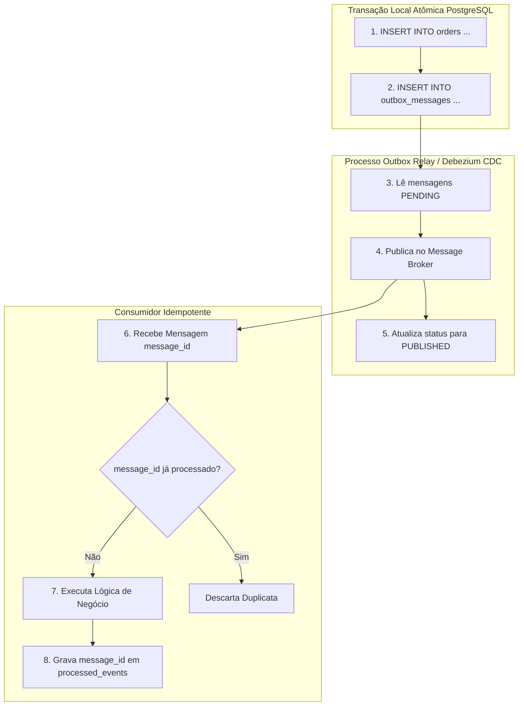

# Guia de Referência 05: EDA, Transactional Outbox & Teoremas Distribuídos

## 1. Classificação de Mensagens em EDA (Martin Fowler)

1. **Event Notification:** Mensagem enxuta que apenas sinaliza um fato (`{"eventType": "OrderCreated", "id": "123"}`). O consumidor precisa buscar detalhes via HTTP síncrono.
2. **Event-Carried State Transfer (ECST):** Mensagem rica que transporta todo o estado necessário. Elimina chamadas de volta, aumentando a resiliência e desacoplamento.
3. **Event Collaboration:** Padrão onde múltiplos serviços cooperam distribuindo a lógica de negócio por meio de eventos encadeados.

---

## 2. O Padrão Transactional Outbox

O problema clássico do **Dual-Write** ocorre quando uma aplicação tenta gravar no banco e publicar na mensageria em duas chamadas de rede sequenciais. Uma falha entre as chamadas gera corrupção de estado distribuído.

---

## 3. Teoremas Fundamentais de Sistemas Distribuídos

### Teorema CAP (Eric Brewer)
Em qualquer sistema distribuído com dados particionados pela rede ($P$), você só pode garantir simultaneamente dois dos três atributos:
- **CP (Consistency + Partition Tolerance):** Prefere consistência absoluta a qualquer custo. Rejeita requisições se houver partição de rede (ex: etcd, Raft, PostgreSQL síncrono).
- **AP (Availability + Partition Tolerance):** Prefere responder sempre com baixa latência, aceitando consistência eventual e leituras potencialmente desatualizadas (ex: Cassandra, DynamoDB).

### Teorema PACELC (Daniel Abadi)
Complementa o CAP detalhando o comportamento do sistema em tempos de normalidade sem falhas de rede:
> **P**artição $\to$ Escolha entre Disponibilidade (**A**) ou Consistência (**C**);  
> **E**lse (em operação normal) $\to$ Escolha entre Latência (**L**) ou Consistência (**C**).
