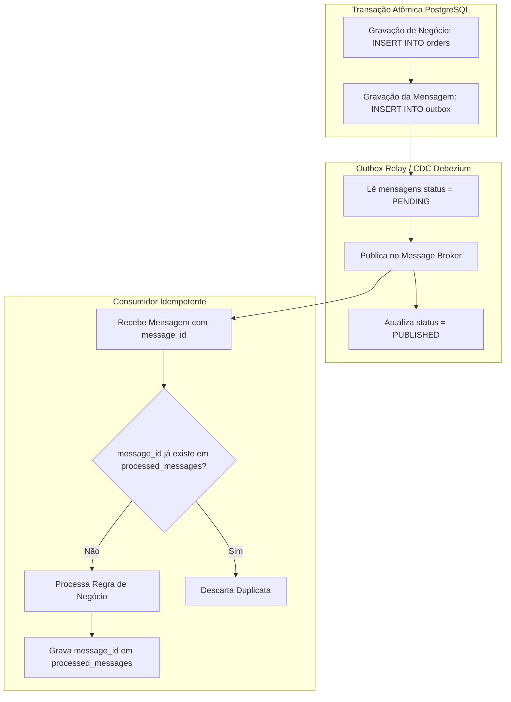

# Guia de Referência 05: EDA, Transactional Outbox & Teoremas Distribuídos

## 1. Classificação de Mensagens em EDA (Martin Fowler)

1. **Event Notification:** Mensagem enxuta apenas notificando que algo mudou (ex: `{"eventType": "OrderPlaced", "orderId": "123"}`). O consumidor precisa fazer uma chamada síncrona de volta para buscar os detalhes.
2. **Event-Carried State Transfer (ECST):** Mensagem rica contendo todo o estado necessário (ex: dados do cliente, itens, total). Permite que o consumidor mantenha sua própria cópia dos dados sem chamadas síncronas adicionais.
3. **Event Collaboration:** Padrão onde múltiplos serviços cooperam disparando eventos que servem como gatilhos para as próximas etapas de um processo de negócio.

---

## 2. Transactional Outbox Pattern

---

## 3. Teorema CAP & Teorema PACELC

### Teorema CAP (Eric Brewer)
Em qualquer sistema distribuído com persistência compartilhada sob partição de rede ($P$):
- **CP (Consistência + Tolerância a Partições):** Rejeita requisições se não puder garantir o dado mais recente (ex: MongoDB com write concern maioritário, etcd).
- **AP (Disponibilidade + Tolerância a Partições):** Responde sempre, mesmo com dados desatualizados / inconsistência temporária (ex: Cassandra, DynamoDB no modo padrão).

### Teorema PACELC (Daniel Abadi)
Se houver partição (**P**), escolha entre Disponibilidade (**A**) ou Consistência (**C**); **E**lse (em operação normal sem partição), escolha entre Latência (**L**) ou Consistência (**C**).
