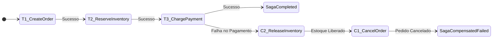

# Guia de Referência 06: Transações Distribuídas & O Padrão Saga

## 1. Por que 2PC (Two-Phase Commit) Falha na Nuvem?

O protocolo 2PC exige um Coordenador central e duas fases de rede síncronas com todos os nós participantes:
1. **Fase 1 (Prepare):** Todos os participantes colocam locks em suas tabelas e garantem que podem comitar.
2. **Fase 2 (Commit):** O coordenador envia a ordem de commit para todos.

**O Problema:** Se um único banco travar ou houver lentidão na rede na Fase 1, todos os nós participantes ficam bloqueados segurando locks de banco, paralisando centenas de outras transações e derrubando o throughput global.

---

## 2. O Padrão Saga (Hector Garcia-Molina & Kenneth Salem)

Uma Saga divide a transação distribuída em uma série de transações locais $T_1, T_2, \dots, T_n$. Cada transação local atualiza o banco de dados do seu serviço e gera eventos/comandos para o próximo passo.

### Transações Compensatórias ($C_i$)
Para cada transação $T_i$, existe uma transação compensatória correspondente $C_i$ que desfaz semanticamente os efeitos de $T_i$:
- Se a Saga falhar no passo $T_k$, o motor executa $C_{k-1}, C_{k-2}, \dots, C_1$ na ordem inversa.

### Orquestração vs Coreografia

| Dimensão | Saga Coreografada | Saga Orquestrada |
|---|---|---|
| **Ponto de Controle** | Descentralizado (eventos puros) | Centralizado (Orquestrador / State Machine) |
| **Complexidade Inicial** | Baixa para fluxos curtos (2-3 passos) | Média (exige coordenador de estados) |
| **Rastreabilidade / Debug** | Difícil (depende de correlação de logs) | Excelente (estado da Saga é persistido) |
| **Risco de Ciclos** | Alto se houver dependências mútuas | Quase nulo |
