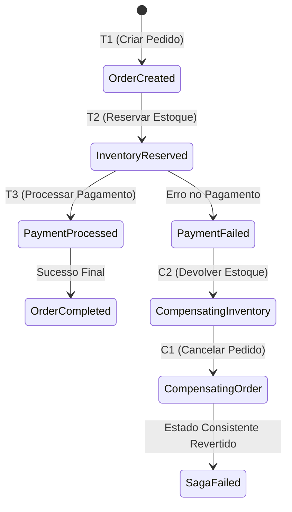

# Guia de Referência 06: Transações Distribuídas & O Padrão Saga

## 1. Por que o Two-Phase Commit (2PC) Não Escala na Nuvem?

O protocolo 2PC (XA Transactions) depende de duas fases síncronas bloqueantes:
1. **Prepare Phase:** O coordenador pergunta a todos os bancos: *"Podem comitar?"*. Todos travam os registros com locks exclusivos.
2. **Commit Phase:** Se todos responderem sim, o coordenador envia o commit.

### O Problema do 2PC
- **Latência Multiplicada:** A transação inteira dura o tempo da chamada de rede mais lenta.
- **Ponto Único de Falha:** Se o coordenador cair durante a fase de prepare, todos os bancos permanecem travados indefinidamente.

---

## 2. O Padrão Saga: Consistência Eventual com Compensação

Uma **Saga** decompõe uma transação distribuída em uma sequência de **transações locais independentes**:
$$T_1, T_2, \dots, T_n$$
Para cada etapa $T_i$, existe uma transação compensatória correspondente $C_i$ que desfaz semanticamente o efeito de $T_i$.

---

## 3. Orquestração vs Coreografia

| Dimensão | Sagas Coreografadas | Sagas Orquestradas |
|---|---|---|
| **Controle** | Descentralizado (serviços reagem a eventos) | Centralizado (Máquina de Estados explícita) |
| **Acoplamento** | Baixo acoplamento pontual | Serviços conhecem os comandos do coordenador |
| **Observabilidade** | Difícil rastrear o estado global | Estado da transação visível em um único log |
| **Complexidade** | Risco de ciclos e tempestade de eventos | Exige infraestrutura de coordenação |
| **Indicação** | Fluxos curtos (2-3 passos) | Transações críticas corporativas (Checkout, Crédito) |
