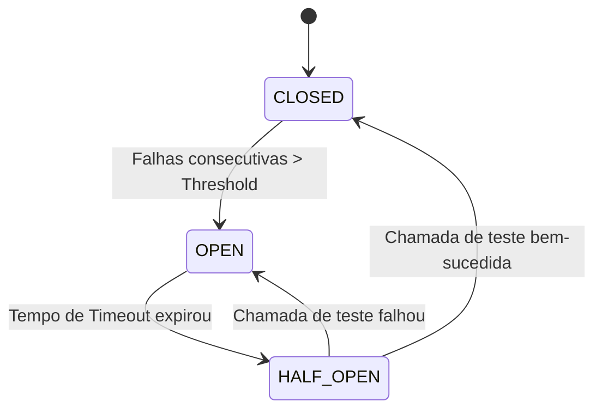

# Guia de Referência 07: Resiliência, Escalabilidade & Padrões Distribuídos

## 1. Padrões de Resiliência

### 1.1 Circuit Breaker
O Circuit Breaker impede que chamadas repetidas a um serviço degradado sobrecarreguem o sistema ou consumam threads indefinidamente:

### 1.2 Bulkhead Pattern
Inspirado nas divisórias estanques de navios que impedem que um furo no casco inunde a embarcação inteira.
No software, limita a quantidade de execuções simultâneas ou threads dedicadas a uma dependência específica (ex: máximo 10 conexões para o serviço de CEP).

### 1.3 Retry com Exponential Backoff e Jitter
Adicionar uma variação aleatória (*Jitter*) ao tempo de espera entre tentativas sucessivas:
$$T_{wait} = \min(T_{max}, T_{base} \times 2^{tentativa}) + \text{random}(0, \text{jitter})$$
Isso impede que milhares de clientes desconectados tentem reconectar exatamente no mesmo milissegundo (*Thundering Herd*).

---

## 2. Estratégias de Cache & Prevenção de Cache Stampede

### 2.1 Padrões de Cache
- **Cache-Aside (Lazy Loading):** A aplicação busca no cache; se der *miss*, busca no banco e grava no cache.
- **Write-Through:** Toda escrita grava simultaneamente no cache e no banco de dados.
- **Write-Behind (Write-Back):** A escrita é feita no cache e confirmada imediatamente; um worker em background grava assincronamente no banco.

### 2.2 Cache Stampede & Single-Flight Mutex
Quando uma chave com alta taxa de leitura expira no cache, centenas de requisições simultâneas geram *cache miss* e atacam o banco ao mesmo tempo.
O padrão **Single-Flight** sincroniza as chamadas em memória: apenas a primeira requisição dispara a busca ao banco; as demais aguardam a mesma Promise ser resolvida.
