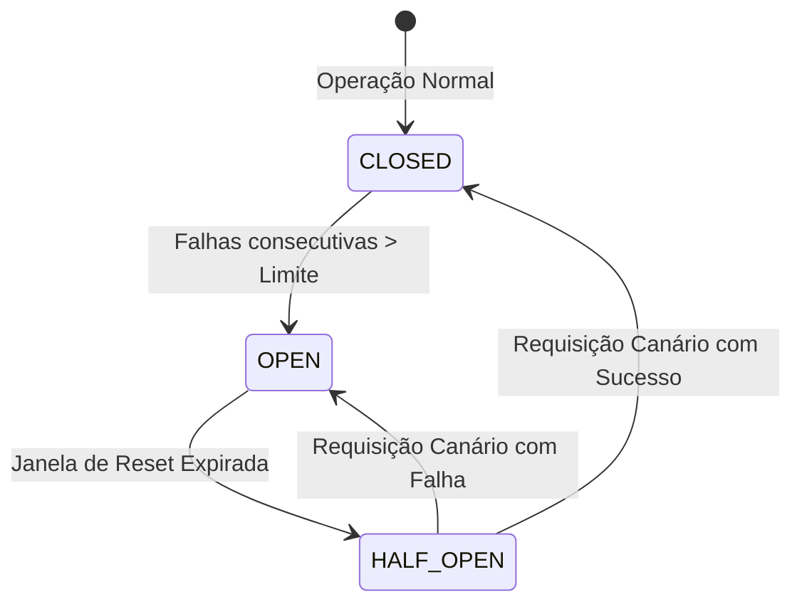
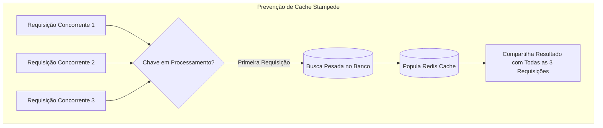

# Guia de Referência 07: Resiliência, Escalabilidade & Padrões Distribuídos

## 1. Padrões de Resiliência Corporativa (Michael Nygard)

Em arquiteturas distribuídas de microsserviços, falhas de rede e lentidões são certezas matemáticas. O objetivo da resiliência é isolar a falha e garantir a continuidade do sistema.

### 1.1 Circuit Breaker (Disjuntor de Rede)

- **CLOSED:** Requisições passam normalmente. Falhas são contabilizadas.
- **OPEN:** Todas as chamadas falham imediatamente (*Fast-Fail* sem bater na rede), evitando desperdício de threads e sockets.
- **HALF-OPEN:** Envia uma única requisição de teste para avaliar se o serviço remoto se recuperou.

### 1.2 Bulkhead (Isolamento de Recursos)
Inspirado nas anteparas dos cascos de navios: se um compartimento inundar, os outros mantêm o navio flutuando.
- Pools de threads e conexões separados por cliente/dependência.
- Se o serviço de cálculo de frete travar, o pool de checkout de cartão continua operando normalmente.

### 1.3 Retry com Exponential Backoff e Jitter
Retentar imediatamente após um erro de rede sobrecarrega o servidor que acabou de cair. A fórmula recomendada adiciona atraso exponencial e aleatoriedade (*Jitter*):
$$T_{\text{wait}} = \min(T_{\text{max}}, T_{\text{base}} \times 2^{\text{tentativa}}) + \text{random}(0, \text{Jitter})$$

---

## 2. Estratégias de Cache & Prevenção de Cache Stampede

- **Single-Flight:** Agrupa múltiplas chamadas concorrentes para a mesma chave em uma única execução de busca no banco, evitando o efeito *Thundering Herd*.
