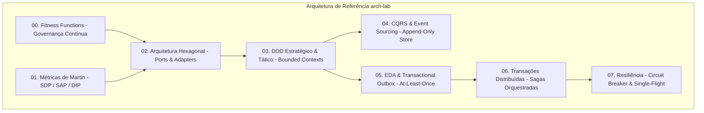

# Guia de Referência 08: Catálogo de Padrões de Arquitetura Corporativa

## 1. Visão Geral da Arquitetura Corporativa de Referência

O **arch-lab** sintetiza os mais rigorosos padrões da indústria em uma arquitetura limpa, testável e escalável:

---

## 2. Matriz de Decisão Arquitetural Corporativa

| Requisito do Sistema | Padrão Recomendado | Anti-Padrão a Evitar |
|---|---|---|
| Regras de negócio complexas | DDD Tático (Agregados Ricos, VOs) | Modelo Anêmico com Getters/Setters |
| Troca flexível de infraestrutura | Arquitetura Hexagonal (Portas Limpas) | ORMs acoplados diretamente ao Domínio |
| Rastreabilidade financeira / Auditoria | Event Sourcing com Append-Only Store | Operações destrutivas `UPDATE` / `DELETE` |
| Mensageria sem perda de dados | Transactional Outbox + Idempotent Consumer | Dual-Write ingênuo (Commit SQL + Publish Broker) |
| Transações entre múltiplos microsserviços | Sagas Orquestradas com Compensação | 2PC (Two-Phase Commit) com locks distribuídos |
| Proteção contra falhas em cascata | Circuit Breaker + Bulkhead + Single-Flight | Loops de retry síncronos sem backoff/jitter |
| Governança de código contínua | Fitness Functions no CI/CD | Confiança exclusiva em Code Review manual |
