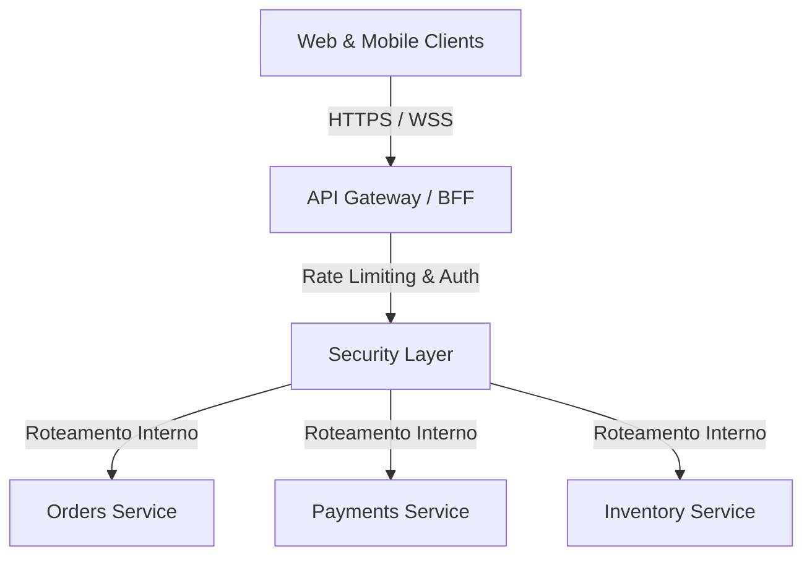

# Guia de Referência 08: Padrões de Arquitetura Corporativa

## 1. Padrões de Integração Corporativa (EIP - Hohpe & Woolf)

1. **Pipes and Filters:** Processamento sequencial de streams onde cada filtro realiza uma transformação determinística sem depender do estado de outros filtros.
2. **Message Router & Message Translator:** Encaminhamento dinâmico de mensagens e tradução de esquemas de dados entre sistemas heterogêneos.
3. **Scatter-Gather:** Disparo paralelo de solicitações para múltiplos fornecedores (ex: cotação de frete) com agregação e escolha da melhor resposta dentro de uma janela de timeout.

---

## 2. Padrões de Gateway & Edge Architecture

- **BFF (Backend for Frontend):** Criação de camadas de agregação específicas por tipo de cliente (ex: BFF Mobile otimizado para payloads enxutos e BFF Web para telas ricas).
- **Service Mesh:** Infraestrutura dedicada (Envoy, Istio) para tratar mTLS, rastreamento distribuído, retries e circuit breaking no nível de rede (L7).
